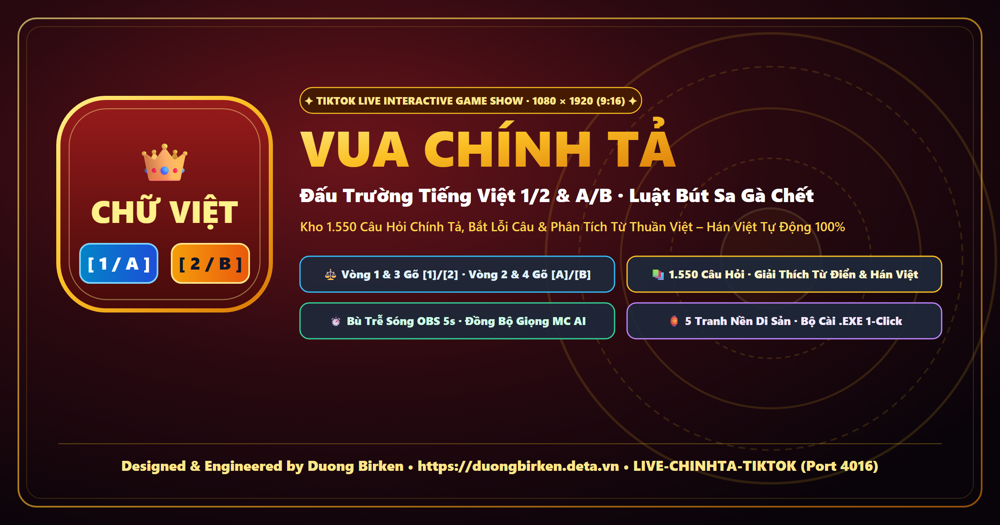
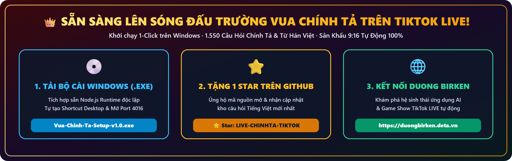

# 💿 Tải Bộ Cài Đặt Windows 1-Click — Vua Chính Tả (`LIVE-CHINHTA-TIKTOK v1.0`)

  

> **Phát triển bởi:** **Duong Birken** — [https://duongbirken.deta.vn](https://duongbirken.deta.vn)  
> **Kho mã nguồn & Trang tải chính thức:** [https://github.com/duongbirken2510/LIVE-CHINHTA-TIKTOK/releases/latest](https://github.com/duongbirken2510/LIVE-CHINHTA-TIKTOK/releases/latest)  
> **Cổng hệ thống mặc định:** `Port 4016` (`http://localhost:4016`)  
> **Link Browser Source cho TikTok LIVE Studio (`1080 × 1920`):** `http://lvh.me:4016/?view=stage`

---

## 📦 1. Danh Sách Gói Cài Đặt & File Chạy Nhanh

| Tệp tin | Vị trí / Đường dẫn | Mô tả & Đối tượng sử dụng |
| :--- | :--- | :--- |
| 💿 **`Vua-Chinh-Ta-Setup-v1.0.exe`** | `release/Vua-Chinh-Ta-Setup-v1.0.exe` | **Bộ cài đặt Windows 1-Click độc lập 100%** (nhúng sẵn `runtime/node.exe`, `node_modules/`, `dist/`, kho `1.550 câu hỏi` và tự tạo biểu tượng **Vua Chính Tả - TikTok LIVE** ngoài màn hình Desktop). Dành cho máy chủ livestream chưa cài Node.js. |
| 🚀 **`Vua-Chinh-Ta.exe`** | `./Vua-Chinh-Ta.exe` | **File Launcher chạy ngầm không hiện cửa sổ CMD đen**: Tự khởi chạy Server trên cổng `4016` và mở giao diện Quản trị Admin trong cửa sổ App riêng biệt. |
| ⚡ **`BAT-LIVE.bat`** | `./BAT-LIVE.bat` | Script khởi chạy nhanh bằng 1 cú nhấp đúp trên Windows. |
| 🔌 **`TAT-LIVE.bat`** | `./TAT-LIVE.bat` | Script gửi lệnh tắt mềm tới `/api/server/shutdown` và giải phóng hoàn toàn `Port 4016`. |

---

## 🛠️ 2. Hướng Dẫn Tự Đóng Gói Lại Bộ Cài `.EXE` Từ Mã Nguồn

Nếu bạn vừa chỉnh sửa kho câu hỏi hoặc giao diện và muốn xuất lại bộ cài `.exe` mới nhất:

1. Nhấp đúp trực tiếp vào file **[`DONG-GOI-EXE.bat`](./DONG-GOI-EXE.bat)** (hoặc gõ lệnh `node build-installer.mjs` trong Terminal).
2. Trình đóng gói sẽ tự động thực hiện:
   - Biên dịch giao diện Production (`vite build` -> `dist/`).
   - Biên dịch `Vua-Chinh-Ta.exe` bằng trình biên dịch `.NET Framework csc.exe` có sẵn trên mọi máy Windows.
   - Đóng gói `runtime/node.exe`, `node_modules/`, `dist/`, `src/` và ghép thành 1 file cài đặt duy nhất tại `release/Vua-Chinh-Ta-Setup-v1.0.exe`.

---

## 🎯 Kêu Gọi Hành Động / Call To Action (CTA)

  

