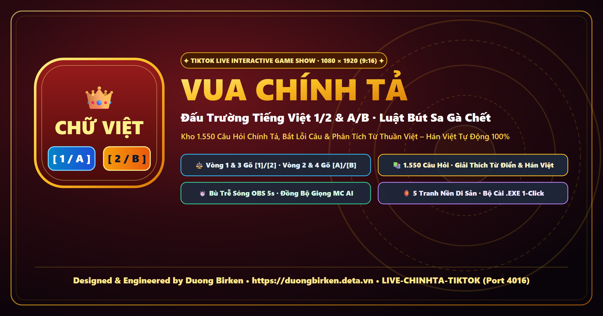
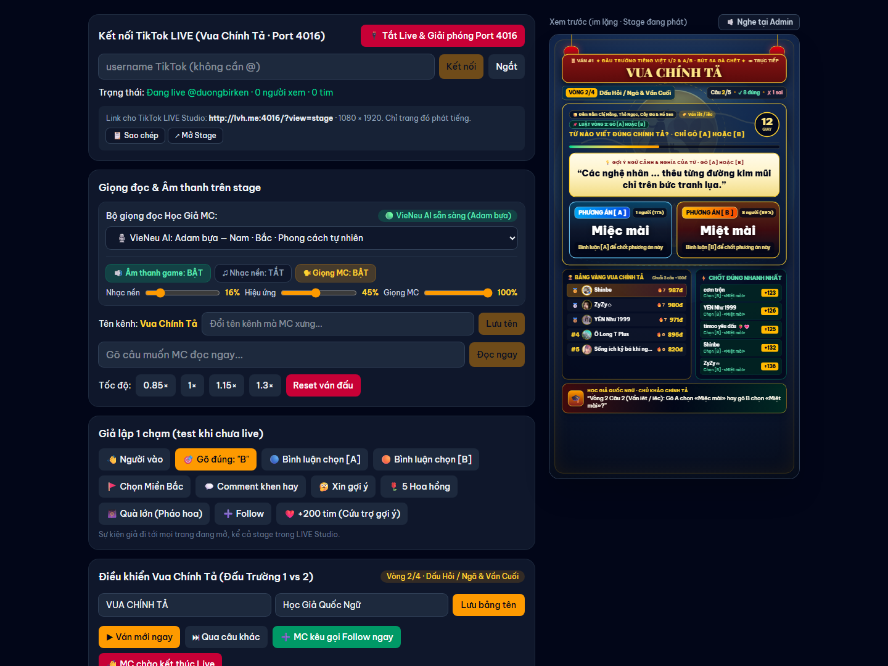
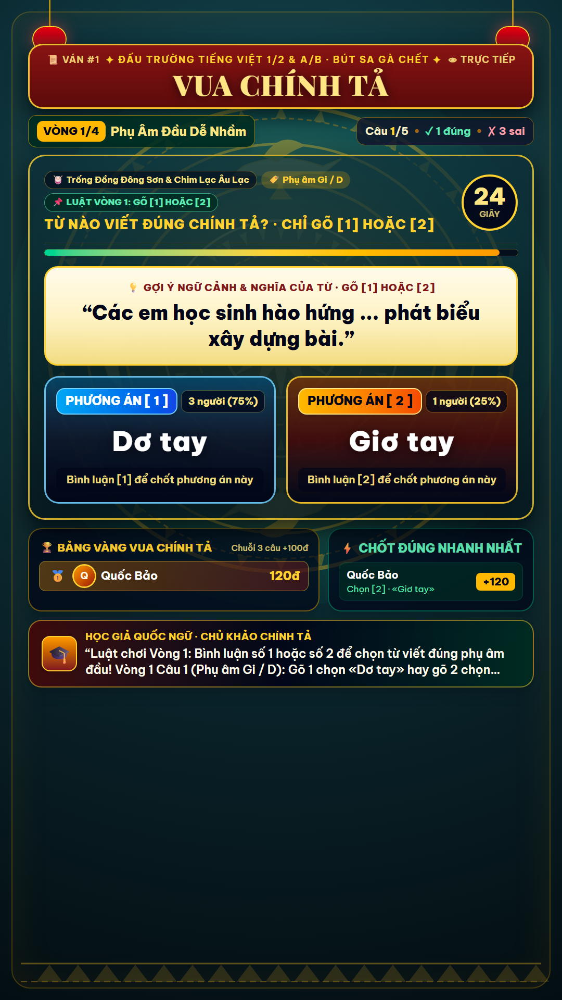
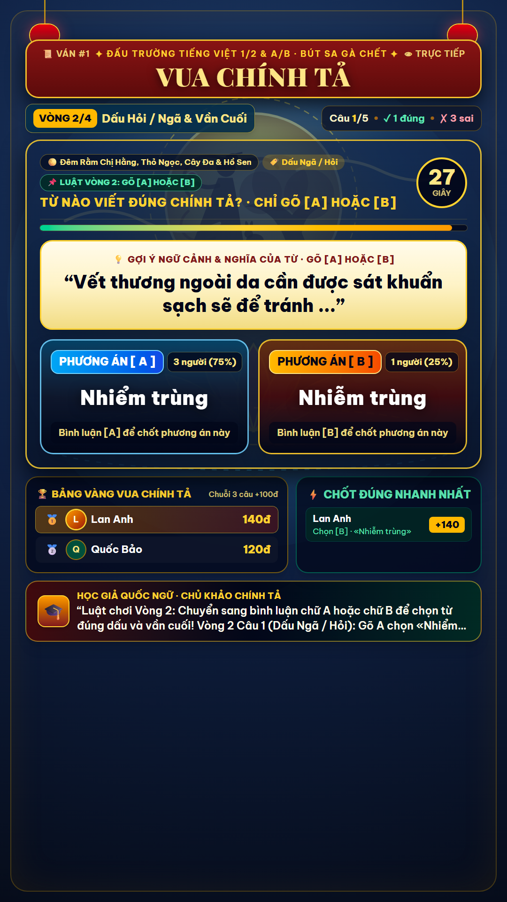
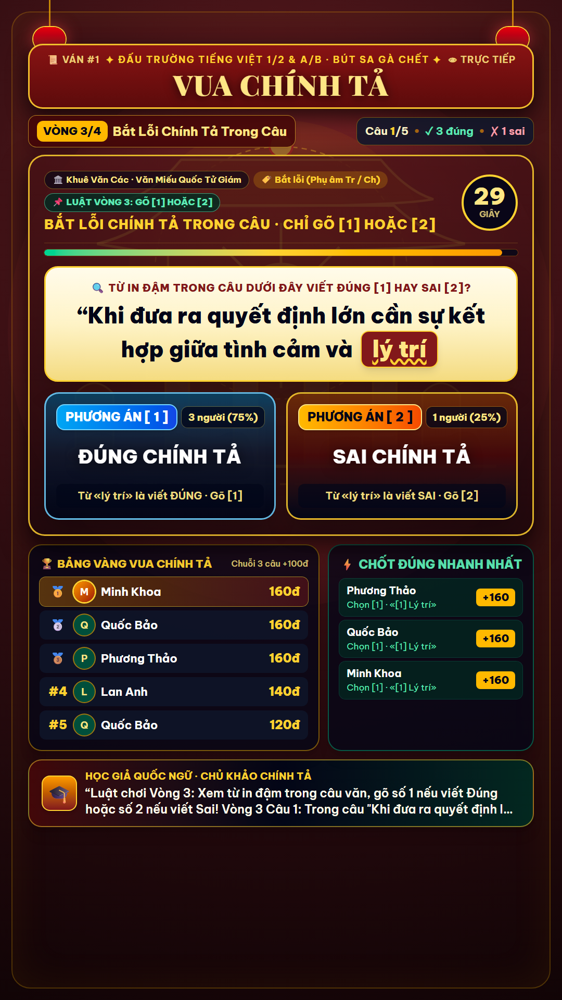
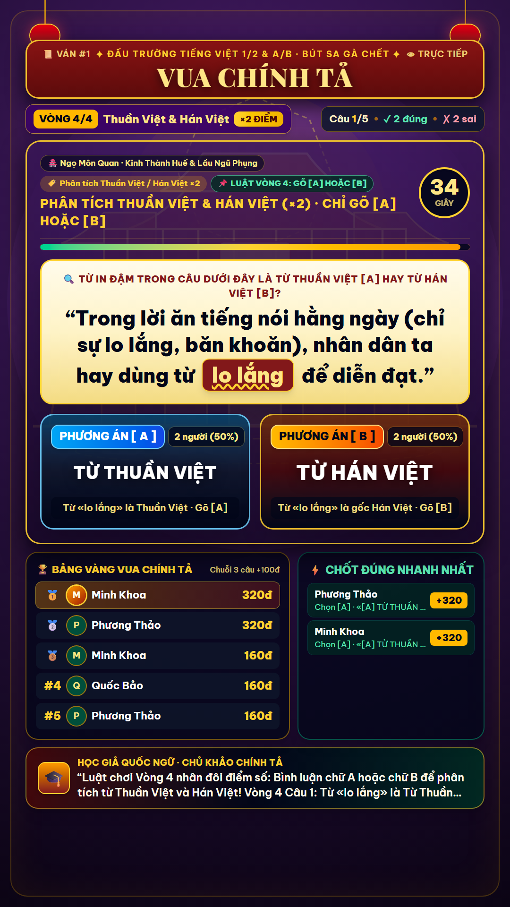
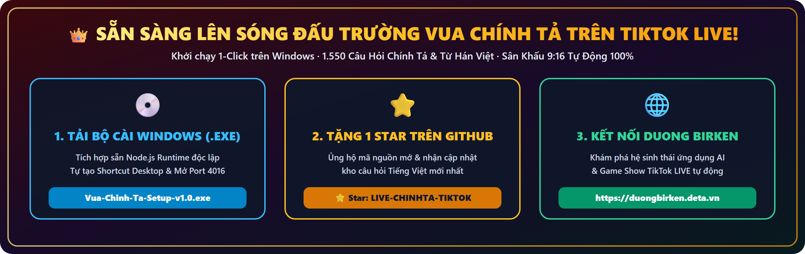

# 👑 Vua Chính Tả — Đấu Trường Tiếng Việt 1/2 & A/B (`LIVE-CHINHTA-TIKTOK`)

<div align="center">
  
  <br /><br />
  <h3>
    💿 👉 <a href="https://github.com/duongbirken2510/LIVE-CHINHTA-TIKTOK/releases/latest"><b>[TẢI NGAY BỘ CÀI ĐẶT WINDOWS 1-CLICK (.EXE)]</b></a> 👈
  </h3>
</div>

> **Game Show Đấu Trường Chính Tả & Từ Vựng Tiếng Việt Siêu Tốc 1 Chạm (`Vòng 1 & 3 Gõ 1/2 · Vòng 2 & 4 Gõ A/B — Luật Bút Sa Gà Chết`), Kho 1.550 Câu Hỏi Độc Nhất, Phân Tích Từ Thuần Việt & Hán Việt `×2` Tự Động 100% Cho TikTok LIVE (`1080 × 1920`)**  
> **Tác giả / Author:** **Duong Birken** — [https://duongbirken.deta.vn](https://duongbirken.deta.vn)  
> **Kho mã nguồn chính thức / Official GitHub Repository:** [https://github.com/duongbirken2510/LIVE-CHINHTA-TIKTOK](https://github.com/duongbirken2510/LIVE-CHINHTA-TIKTOK)  
> **Bộ cài đặt Windows 1-Click (`.EXE`):** [`release/Vua-Chinh-Ta-Setup-v1.0.exe`](./release/Vua-Chinh-Ta-Setup-v1.0.exe) · [`DOWNLOAD_APP.md`](./DOWNLOAD_APP.md)

---

## 📚 Tài Liệu Chi Tiết Dự Án

| Tài liệu | Đường dẫn | Nội dung chính |
| :--- | :--- | :--- |
| 💿 **Tải Bộ Cài Đặt Windows 1-Click (`.EXE`)** | [**`DOWNLOAD_APP.md`**](./DOWNLOAD_APP.md) | Hướng dẫn cài đặt `Vua-Chinh-Ta-Setup-v1.0.exe` (tích hợp sẵn Node.js Runtime độc lập, tự tạo biểu tượng Desktop) và `Vua-Chinh-Ta.exe`. |
| 👑 **Hồ Sơ Giới Thiệu Sản Phẩm & Công Nghệ (10 Chương)** | [**`info/Introduce_VuaChinhTa.md`**](./info/Introduce_VuaChinhTa.md) | Định nghĩa sản phẩm, cơ chế `1/2` & `A/B` theo vòng, luật Bút Sa Gà Chết (`lockedChoices`), miễn trừ 5s trễ OBS, đồng bộ giọng MC `Voice-Sync Hold` và kiến trúc kỹ thuật. |
| 📖 **Cẩm Nang Hướng Dẫn Sử Dụng Toàn Tập (A–Z · VI/EN)** | [**`docs/USER_GUIDE.md`**](./docs/USER_GUIDE.md) | Hướng dẫn song ngữ VI/EN kèm ảnh chụp màn hình thực tế: cài đặt `.exe` / `.bat`, nhúng Browser Source `1080 × 1920` vào TikTok LIVE Studio, chỉnh thời gian 4 vòng & thời gian mở đáp án. |

---

## 🚀 Khởi Chạy Nhanh & Thông Số Cổng Hệ Thống (`Port 4016`)

- **Chạy 1-Click trên Windows:** Nhấp đúp [`BAT-LIVE.bat`](./BAT-LIVE.bat) hoặc [`Vua-Chinh-Ta.exe`](./Vua-Chinh-Ta.exe) (tắt nhanh & giải phóng cổng bằng [`TAT-LIVE.bat`](./TAT-LIVE.bat) hoặc nút đỏ **`🔌 Tắt Live & Giải phóng Port 4016`** trên đỉnh trang Admin).
- **Trang Quản trị Admin:** `http://localhost:4016`
- **Link Browser Source cho TikTok LIVE Studio (`1080 × 1920`, dọc 9:16):** `http://lvh.me:4016/?view=stage`
- **Vite HMR Port:** `24686`

```bash
npm install
npm run dev    # Khởi chạy Server + Admin + Stage trên cổng 4016
npm run lint   # Kiểm tra kiểu TypeScript (tsc --noEmit)
npm test       # Chạy 20 bài kiểm thử tự động (src/game/chinhta.check.ts)
npm run build  # Đóng gói giao diện Production (dist/)
```

---

## 📸 Hình Ảnh Giao Diện Thực Tế (`Admin Dashboard` & `Sân Khấu 9:16`)

### 1. Trang Quản Trị Admin (`http://localhost:4016`)


### 2. Sân Khấu 4 Vòng Thi (`1080 × 1920` · Dọc `9:16` Cho TikTok LIVE Studio / OBS)
| Vòng 1: Phụ Âm Đầu (`Gõ [1] / [2]`) | Vòng 2: Dấu Hỏi/Ngã & Vần Cuối (`Gõ [A] / [B]`) |
| :---: | :---: |
|  |  |
| **Vòng 3: Bắt Lỗi Trong Câu (`Gõ [1] / [2]`)** | **Vòng 4: Thuần Việt & Hán Việt `×2` (`Gõ [A] / [B]`)** |
|  |  |

---

## ⚖️ Cơ Chế Gameplay Cốt Lõi: "Vòng 1 & 3 Gõ `1 / 2` · Vòng 2 & 4 Gõ `A / B` — Bút Sa Gà Chết"

1. **Tương tác siêu tốc 1 chạm theo từng vòng (`[1]/[2]` & `[A]/[B]`):**
   - **Vòng 1 & Vòng 3:** Khán giả bình luận **`1`** hoặc **`2`** (`"1"`, `"2"`, `"số 1"`, `"2 nha"`, `"chọn 1"`...).
   - **Vòng 2 & Vòng 4:** Khán giả chuyển sang bình luận **`A`** hoặc **`B`** (`"A"`, `"B"`, `"câu A"`, `"chọn B"`, `"A nha"`, `"B ạ"`...).
   - **Giới thiệu luật chơi đầu mỗi vòng:** Ở màn hình Chuyển Vòng và Câu 1 của mỗi vòng, Học Giả MC tự động giới thiệu rõ luật gõ phím của vòng đó, giúp khán giả không bị bất ngờ giữa chừng, đồng thời triệt tiêu lỗi trôi bình luận trễ từ vòng trước.
2. **Luật "Bút Sa Gà Chết" (Chống spam đáp án & chống quay xe):**
   - Trong mỗi câu hỏi, hệ thống **chỉ ghi nhận lựa chọn ĐẦU TIÊN** của mỗi người chơi (`lockedChoices: Map<playerId, 1 | 2>`).
   - Chọn **ĐÚNG** ngay lần đầu: Cộng điểm tốc độ (kèm **miễn trừ 5 giây đầu câu bù độ trễ OBS** để người xem trên điện thoại vẫn đạt 100% điểm tối đa) + thưởng nóng **`+100đ`** mỗi khi đạt chuỗi 3 câu đúng liên tiếp.
   - Chọn **SAI** ở lần đầu: Cắt chuỗi thắng (`streak = 0`) và **khóa luôn câu đó** (`kind: 'locked_wrong'` nếu quay xe gõ lại phương án kia).
3. **Sân Khấu 9:16 Tinh Gọn Cỡ Chữ Lớn (`42px – 52px`) & Thẻ Phương Án 1 Hàng Duy Nhất:**
   - Khung Cuốn Thư Đề Bài màu vàng hiển thị nổi bật ở chính giữa màn hình với cỡ chữ **`38px – 44px`** giúp người lướt TikTok trên điện thoại đọc rõ ngay trong 0.5 giây.
   - Hai thẻ phương án ép **1 hàng duy nhất (`whitespace-nowrap`)** kèm thống kê số người & tỷ lệ `%` bình chọn thời gian thực ngay góc trên mỗi thẻ.
4. **Hộp Giải Thích Từ Điển & Đồng Bộ Giọng Đọc `Voice-Sync Hold`:**
   - Khi hết giờ (`phase === 'reveal'`, `9s – 16.5s` tự co giãn theo độ dài câu và số dấu câu), hộp **`📖 GIẢI THÍCH NGỮ NGHĨA / PHÂN TÍCH THUẦN VIỆT & HÁN VIỆT`** bật sáng và Học Giả MC đọc trọn vẹn lời giải thích.
   - Cơ chế **`Voice-Sync Hold`** đảm bảo hệ thống luôn đợi MC đọc dứt chữ cuối cùng (+`0.45s` nghỉ lấy hơi) rồi mới chuyển sang cảnh tiếp theo, không bao giờ cắt ngang lời MC.

---

## 🏮 Cấu Trúc 4 Vòng Thi (1.550 Câu Hỏi Độc Nhất) & 5 Bức Tranh Nền Di Sản Văn Hóa

| Vòng thi | Kho câu hỏi | Ký hiệu bình luận | Bối cảnh Di sản Văn hóa (`StageBackgroundArtwork`) | Nội dung thử thách & Điểm số |
| :--- | :---: | :---: | :--- | :--- |
| **Vòng 1**<br>*Phụ Âm Đầu Dễ Nhầm* | **420 câu** | **`[ 1 ]` hoặc `[ 2 ]`** | 🥁 **Trống Đồng Đông Sơn & Chim Lạc Âu Lạc** | Phân biệt `S/X`, `Ch/Tr`, `D/Gi/R`, `L/N`, `G/Gh`, `Ng/Ngh`, `V/D` (`50đ – 120đ`). |
| **Vòng 2**<br>*Dấu Hỏi/Ngã & Vần Cuối* | **450 câu** | **`[ A ]` hoặc `[ B ]`** | 🌕 **Đêm Rằm Chị Hằng, Thỏ Ngọc, Cây Đa & Hồ Sen** | Phân biệt `?/~`, `c/t`, `n/ng`, `i/y`, `ao/au`, `ai/ay`, `iu/iêu`, `uôn/uân` (`60đ – 140đ`). |
| **Vòng 3**<br>*Bắt Lỗi Trong Câu* | **360 câu** | **`[ 1 ]` hoặc `[ 2 ]`** | 🏛️ **Khuê Văn Các · Văn Miếu Quốc Tử Giám** | Đọc từ khóa in đậm trong câu văn: Gõ **`1` (`ĐÚNG CHÍNH TẢ`)** hoặc **`2` (`SAI CHÍNH TẢ`)** (`70đ – 160đ`). |
| **Vòng 4**<br>*Thuần Việt & Hán Việt ×2* | **320 câu** | **`[ A ]` hoặc `[ B ]`** | 🏯 **Ngọ Môn Quan · Kinh Thành Huế & Lầu Ngũ Phụng** | `160 câu Dạng 4A` (Phân tích từ in đậm trong câu là **TỪ THUẦN VIỆT** hay **TỪ HÁN VIỆT**) + `160 câu Dạng 4B` (Đối chiếu 2 từ đồng nghĩa tìm từ Thuần Việt / Hán Việt) (`160đ – 320đ`). |
| **Chuyển Vòng & Đăng Quang** | — | — | 👑 **Điện Thái Hòa · Vinh Quy Bái Tổ** | Tổng kết chặng, giới thiệu luật vòng mới, vinh danh Tam Tài và lưu Bảng Vàng Tuần. |

---

## 🎯 Kêu Gọi Hành Động / Call To Action (CTA)

<div align="center">
  <a href="https://github.com/duongbirken2510/LIVE-CHINHTA-TIKTOK/releases/latest">
    
  </a>
  <br /><br />
  <h3>
    💿 <a href="https://github.com/duongbirken2510/LIVE-CHINHTA-TIKTOK/releases/latest"><b>[1. TẢI NGAY BỘ CÀI WINDOWS 1-CLICK (.EXE)]</b></a>
    &nbsp;·&nbsp;
    ⭐ <a href="https://github.com/duongbirken2510/LIVE-CHINHTA-TIKTOK"><b>[2. TẶNG 1 STAR TRÊN GITHUB]</b></a>
    &nbsp;·&nbsp;
    🌐 <a href="https://duongbirken.deta.vn"><b>[3. GHÉ THĂM DUONGBIRKEN.DETA.VN]</b></a>
  </h3>
</div>

---

## 👨‍💻 Tác Giả & Liên Hệ / Author & Contact

| 🇻🇳 Lời nhắn từ Tác giả | 🇬🇧 Note from the Author |
| :--- | :--- |
| **Vua Chính Tả (`LIVE-CHINHTA-TIKTOK`)** là dự án tâm huyết được phát triển bởi **Duong Birken**. Nếu dự án hữu ích với bạn, hãy tặng một ngôi sao (**⭐ Star**) trên GitHub hoặc ghé thăm website chính thức để kết nối, khám phá thêm các công cụ livestream tương tác tự động và góp ý nhé! | **Vua Chính Tả (`LIVE-CHINHTA-TIKTOK`)** is crafted with passion by **Duong Birken**. If you find this project helpful, please consider giving it a **⭐ Star** on GitHub or visiting the official website to connect and share your feedback! |

- **🌐 Website chính thức & Liên hệ tác giả:** [**https://duongbirken.deta.vn**](https://duongbirken.deta.vn)
- **🐙 GitHub Profile:** [**https://github.com/duongbirken2510**](https://github.com/duongbirken2510)
- **📦 Kho mã nguồn dự án:** [**https://github.com/duongbirken2510/LIVE-CHINHTA-TIKTOK**](https://github.com/duongbirken2510/LIVE-CHINHTA-TIKTOK)
- **👑 Hồ sơ Giới thiệu Sản phẩm & Công nghệ 10 Chương (`info/`):** [**info/Introduce_VuaChinhTa.md**](./info/Introduce_VuaChinhTa.md)
- **📖 Cẩm nang Hướng dẫn Sử dụng A–Z (`docs/USER_GUIDE.md`):** [**docs/USER_GUIDE.md**](./docs/USER_GUIDE.md)
