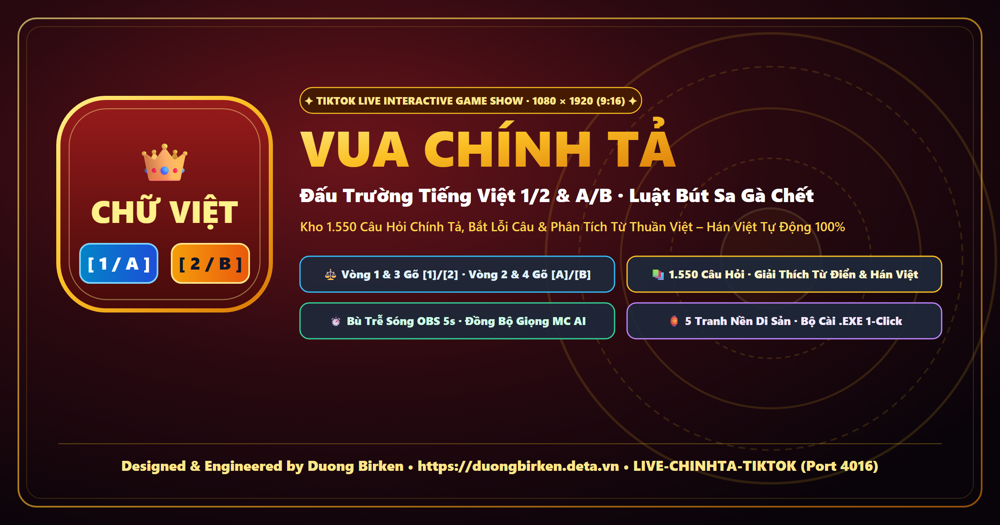

# 👑 RELEASE NOTES — Vua Chính Tả (`LIVE-CHINHTA-TIKTOK` v1.0.0)

  

> **Tác giả / Author:** **Duong Birken** — [https://duongbirken.deta.vn](https://duongbirken.deta.vn)  
> **Kho mã nguồn / Repository:** [https://github.com/duongbirken2510/LIVE-CHINHTA-TIKTOK](https://github.com/duongbirken2510/LIVE-CHINHTA-TIKTOK)  
> **Cổng mặc định / Default Port:** `http://localhost:4016` (Admin) · `http://lvh.me:4016/?view=stage` (TikTok LIVE Studio `1080 × 1920`)

---

## 🇻🇳 Điểm Mới Nổi Bật (v1.0.0)
1. **Cơ chế Gameplay theo vòng (`Vòng 1 & 3 Gõ 1/2 · Vòng 2 & 4 Gõ A/B`) & Luật "Bút Sa Gà Chết" (`ChinhTaEngine`):**
   - Khóa chặt lựa chọn đầu tiên của mỗi người chơi (`lockedChoices`), chống spam cả 2 đáp án (`kind: 'locked_wrong'`).
   - Học Giả MC tự động giới thiệu luật chơi ở đầu mỗi vòng và tại màn hình chuyển vòng.
2. **Kho Đề Khủng 1.550 Câu Hỏi Độc Nhất & Vòng 4 Phân Tích Từ Thuần Việt – Hán Việt `×2`:**
   - **Vòng 1 (`420 câu`):** Phụ âm đầu dễ nhầm (`S/X, Ch/Tr, D/Gi/R, L/N, G/Gh, Ng/Ngh, V/D` · Trống Đồng Đông Sơn).
   - **Vòng 2 (`450 câu`):** Dấu Hỏi/Ngã & Vần cuối (`?/~, c/t, n/ng, i/y, ao/au, ai/ay, iu/iêu, uôn/uân` · Đêm Rằm Chị Hằng).
   - **Vòng 3 (`360 câu`):** Bắt lỗi chính tả trong câu văn (`[1] ĐÚNG CHÍNH TẢ` vs `[2] SAI CHÍNH TẢ` · Khuê Văn Các).
   - **Vòng 4 (`320 câu · ×2 Điểm`):** Phân tích nguồn gốc **Từ Thuần Việt & Từ Hán Việt** (`160 câu Dạng 4A` phân tích từ in đậm trong câu + `160 câu Dạng 4B` đối chiếu 2 từ đồng nghĩa · Ngọ Môn Kinh Thành Huế).
3. **Miễn Trừ 5 Giây Đầu Bù Trễ OBS (`buTreObsMs: 5000`) & Đồng Bộ Giọng Đọc `Voice-Sync Hold`:**
   - Người xem trên điện thoại bị trễ sóng OBS 4–5 giây trả lời ngay khi thấy đề vẫn đạt 100% điểm tối đa.
   - Cơ chế `Voice-Sync Hold` đợi Học Giả MC đọc dứt câu giải thích từ điển (+`0.45s` nghỉ lấy hơi) rồi mới chuyển cảnh.
4. **Sân Khấu 9:16 Tinh Gọn Cỡ Chữ Lớn (`42px – 52px`), 2 Thẻ Phương Án 1 Hàng Duy Nhất & Bộ Cài Windows 1-Click (`Vua-Chinh-Ta-Setup-v1.0.exe`).**

---

## 🇬🇧 Release Highlights (v1.0.0)
- **Per-Round 1-Tap Choice Engine (`1/2` for Rounds 1 & 3 · `A/B` for Rounds 2 & 4)** with **"Bút Sa Gà Chết" First-Choice Lock** and automated round-start rule introductions.
- **1,550 Unique Vietnamese Orthography & Etymology Questions** across 4 heritage-themed rounds, including a 320-question **Native Vietnamese vs. Sino-Vietnamese Analysis Round (`×2` Points)**.
- **5-Second OBS Stream Latency Grace Window** + **`Voice-Sync Hold` Scene Transitions** + **3-Channel WebAudio Mixer (`95%` Pre-Ducking & `1.55×` Voice Boost)**.

---

## 👨‍💻 Tác Giả & Liên Hệ / Author & Contact

| 🇻🇳 Lời nhắn từ Tác giả | 🇬🇧 Note from the Author |
| :--- | :--- |
| **Vua Chính Tả (`LIVE-CHINHTA-TIKTOK`)** được phát triển bởi **Duong Birken**. Hãy tặng 1 **⭐ Star** trên GitHub hoặc ghé thăm [https://duongbirken.deta.vn](https://duongbirken.deta.vn) để kết nối nhé! | **Vua Chính Tả (`LIVE-CHINHTA-TIKTOK`)** is created by **Duong Birken**. Give it a **⭐ Star** on GitHub or visit [https://duongbirken.deta.vn](https://duongbirken.deta.vn)! |
