# 📖 CẨM NANG HƯỚNG DẪN SỬ DỤNG VUA CHÍNH TẢ TOÀN TẬP (A–Z)
## Vua Chính Tả — Đấu Trường Tiếng Việt 1/2 & A/B (`LIVE-CHINHTA-TIKTOK` v1.0.0) — Bilingual User Guide (Tiếng Việt & English)

<div align="center">
  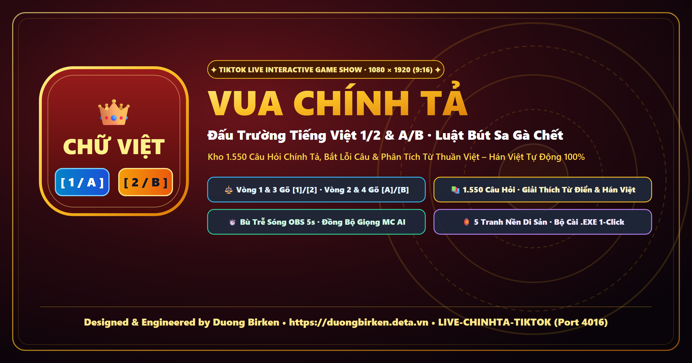
  <br /><br />
  <h3>
    💿 👉 <a href="https://github.com/duongbirken2510/LIVE-CHINHTA-TIKTOK/releases/latest"><b>[TẢI NGAY BỘ CÀI ĐẶT WINDOWS 1-CLICK (.EXE)]</b></a> 👈
    &nbsp;·&nbsp;
    🎬 👉 <a href="../Record_2026-vua-chinh-ta.mp4"><b>[XEM VIDEO QUAY PHÒNG LIVE THỰC TẾ (.MP4)]</b></a> 👈
  </h3>
</div>

> **Tác giả / Author:** **Duong Birken** — [https://duongbirken.deta.vn](https://duongbirken.deta.vn)  
> **Trang sản phẩm chính thức / Official Product Repository:** [https://github.com/duongbirken2510/LIVE-CHINHTA-TIKTOK](https://github.com/duongbirken2510/LIVE-CHINHTA-TIKTOK)  
> **Tải bộ cài đặt / Download Installers:** [GitHub Releases v1.0.0](https://github.com/duongbirken2510/LIVE-CHINHTA-TIKTOK/releases/latest) · [`../DOWNLOAD_APP.md`](../DOWNLOAD_APP.md)  
> **Hồ sơ Giới thiệu Sản phẩm & Công nghệ (10 Chương):** [`../info/Introduce_VuaChinhTa.md`](../info/Introduce_VuaChinhTa.md)  
> **Video Demo Phiên LIVE Thực Tế (`1080 × 1920`):** [`../Record_2026-vua-chinh-ta.mp4`](../Record_2026-vua-chinh-ta.mp4)  
> **Cổng vận hành mặc định / Default Ports:** Admin `http://localhost:4016` · TikTok LIVE Studio Stage `http://lvh.me:4016/?view=stage`

---

## 🎬 Xem Nhanh Video Vận Hành Thực Tế Trên Sóng TikTok LIVE (`Record_2026-vua-chinh-ta.mp4`)

<div align="center">
  <a href="../Record_2026-vua-chinh-ta.mp4">
    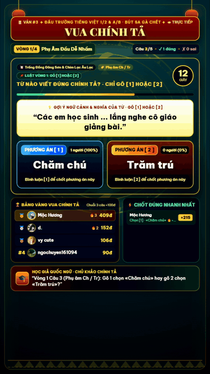
  </a>
  <p>
    <i>▶️ Bấm vào ảnh động GIF hoặc mở trực tiếp <a href="../Record_2026-vua-chinh-ta.mp4"><b><code>Record_2026-vua-chinh-ta.mp4</code></b></a> để xem phiên đấu trường thực tế (1080×1920 · 30fps · Có âm thanh Học Giả MC AI).</i>
  </p>
</div>

---

## 📑 Mục Lục Nhanh / Quick Navigation
- **Phần A — 🇻🇳 Hướng Dẫn Sử Dụng Tiếng Việt (Từ A đến Z)**
  1. [Bước 1: Tải & Cài đặt nhanh 1-Click trên Windows, macOS và Linux](#1-bước-1-tải--cài-đặt-nhanh-1-click-trên-windows-macos-và-linux)
  2. [Bước 2: Nhúng sân khấu 1080×1920 vào TikTok LIVE Studio / OBS & Kết nối tài khoản](#2-bước-2-nhúng-sân-khấu-10801920-vào-tiktok-live-studio--obs--kết-nối-tài-khoản)
  3. [Bước 3: Làm chủ luật chơi theo vòng (`Vòng 1 & 3 Gõ 1/2 · Vòng 2 & 4 Gõ A/B`), Mở Đáp Án `4s` & Kho 1.550 câu hỏi](#3-bước-3-làm-chủ-luật-chơi-theo-vòng-vòng-1--3-gõ-12--vòng-2--4-gõ-ab-mở-đáp-án-4s--kho-1550-câu-hỏi)
  4. [Bước 4: Chỉnh thời gian đoán bù trễ OBS 5s, Thời gian mở đáp án `4s` & Bàn trộn âm thanh 3 kênh](#4-bước-4-chỉnh-thời-gian-đoán-bù-trễ-obs-5s-thời-gian-mở-đáp-án-4s--bàn-trộn-âm-thanh-3-kênh)
  5. [Bước 5: Quản lý dữ liệu Bảng Vàng Tuần, Lịch sử 1.550 câu hỏi & Sao lưu](#5-bước-5-quản-lý-dữ-liệu-bảng-vàng-tuần-lịch-sử-1550-câu-hỏi--sao-lưu)
  6. [Bước 6: Mẹo tối ưu tương tác Follow tự động & Xử lý sự cố thường gặp](#6-bước-6-mẹo-tối-ưu-tương-tác-follow-tự-động--xử-lý-sự-cố-thường-gặp)
- **Part B — 🇬🇧 English User Guide (Step-by-Step)**
  1. [Step 1: Installation on Windows, macOS, and Linux (Port 4016)](#step-1-installation-on-windows-macos-and-linux-port-4016)
  2. [Step 2: Initial Setup & Adding the 1080×1920 Stage to TikTok LIVE Studio / OBS](#step-2-initial-setup--adding-the-10801920-stage-to-tiktok-live-studio--obs)
  3. [Step 3: Per-Round Gameplay (`1/2` & `A/B`), Fast `4s` Reveal & 1,550-Question Bank](#step-3-per-round-gameplay-12--ab-fast-4s-reveal--1550-question-bank)
  4. [Step 4: Storage Management, Backup & Troubleshooting](#step-4-storage-management-backup--troubleshooting)

---

# 🇻🇳 PHẦN A — HƯỚNG DẪN SỬ DỤNG TIẾNG VIỆT (TỪ A ĐẾN Z)

## 1. Bước 1: Tải & Cài đặt nhanh 1-Click trên Windows, macOS và Linux

### 💻 A. Trên máy tính Windows 10 / 11 (64-bit) — Bộ cài `.EXE` 1-Click hoặc `.BAT`
1. Tải bộ cài đặt chính thức: **[`Vua-Chinh-Ta-Setup-v1.0.exe`](https://github.com/duongbirken2510/LIVE-CHINHTA-TIKTOK/releases/latest)** (hoặc mở trực tiếp trong thư mục `release/Vua-Chinh-Ta-Setup-v1.0.exe`).
2. Nhấp đúp vào file vừa tải về. Nếu Windows hiện bảng xanh *Windows protected your PC (SmartScreen)*:
   - Bấm vào chữ **More info** (*Thông tin thêm*).
   - Bấm nút **Run anyway** (*Vẫn chạy*).
3. Bấm nút **`🚀 CÀI ĐẶT NGAY (1-CLICK)`**:
   - Bộ cài đã tích hợp sẵn `runtime/node.exe` độc lập (không cần cài Node.js trước), tự động tạo biểu tượng **`Vua Chính Tả - TikTok LIVE`** ngoài màn hình Desktop và mở ngay trang Quản trị Admin tại **`http://localhost:4016`**.
4. **Hoặc khởi chạy trực tiếp từ thư mục mã nguồn:**
   - Nhấp đúp vào file **[`BAT-LIVE.bat`](../BAT-LIVE.bat)** hoặc **[`Vua-Chinh-Ta.exe`](../Vua-Chinh-Ta.exe)** để bật Live.
   - Khi muốn tắt Server và giải phóng hoàn toàn cổng `4016`: Bấm nút màu đỏ **`🔌 Tắt Live & Giải phóng Port 4016`** ở góc trên bên phải trang Admin, hoặc nhấp đúp file **[`TAT-LIVE.bat`](../TAT-LIVE.bat)**.

### 🍎 B. Trên máy MacBook / iMac (macOS) & 🐧 Linux
```bash
# Yêu cầu Node.js >= 20:
npm install
npm run dev
# Mở trình duyệt tại http://localhost:4016 (Admin) và http://lvh.me:4016/?view=stage (Stage 9:16)
```

---

## 2. Bước 2: Nhúng sân khấu 1080×1920 vào TikTok LIVE Studio / OBS & Kết nối tài khoản

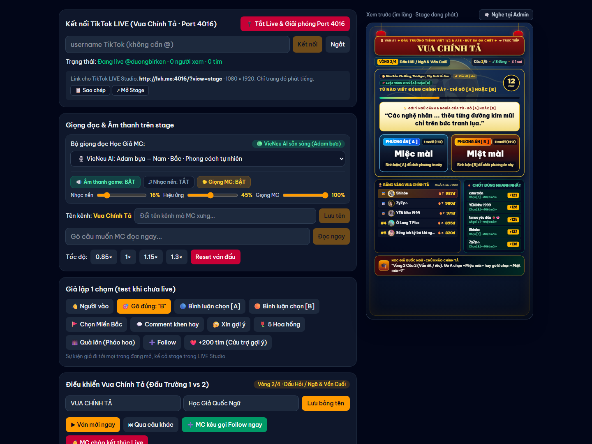

1. Trên trang Quản trị Admin (`http://localhost:4016`), tại khung **Kết nối TikTok LIVE (Vua Chính Tả · Port 4016)**, bấm nút **`📋 Sao chép`** để chép đường dẫn sân khấu:
   **`http://lvh.me:4016/?view=stage`**
2. Mở phần mềm **TikTok LIVE Studio** (hoặc **OBS Studio**) ở chế độ khung hình dọc `9:16`:
   - Bấm **Thêm nguồn (Add Source)** ➔ chọn **Liên kết (Link / Browser Source)**.
   - Dán đường dẫn: **`http://lvh.me:4016/?view=stage`**.
   - Thiết lập kích thước: Chiều rộng **`1080`** × Chiều cao **`1920`**.
3. Sau khi bạn đã bấm **Phát trực tiếp (Go LIVE)** trên TikTok LIVE Studio:
   - Quay lại trang Admin (`http://localhost:4016`), nhập `username` TikTok của bạn (không cần gõ chữ `@`) vào ô nhập liệu ➔ bấm nút **`Kết nối`**.
   - Dòng trạng thái sẽ chuyển sang màu xanh lá: **`Đang live @username · XX người xem · YY tim`**.

---

## 3. Bước 3: Làm chủ luật chơi theo vòng (`Vòng 1 & 3 Gõ 1/2 · Vòng 2 & 4 Gõ A/B`), Mở Đáp Án `4s` & Kho 1.550 câu hỏi

### ⚖️ A. Cơ chế phân bổ `1 / 2` và `A / B` theo từng vòng + Mở đáp án siêu tốc `4 giây`
- Hệ thống chia bộ ký hiệu bình luận cố định theo từng vòng để khán giả không bị giật mình giữa chừng mà vẫn **triệt tiêu 100% lỗi trôi đáp án khi chuyển vòng do trễ sóng OBS**:
  - **Vòng 1 & Vòng 3:** Khán giả bình luận số **`1`** hoặc **`2`** (`"1"`, `"2"`, `"số 1"`, `"2 nha"`, `"chọn 1"`...).
  - **Vòng 2 & Vòng 4:** Khán giả chuyển sang bình luận chữ **`A`** hoặc **`B`** (`"A"`, `"B"`, `"câu A"`, `"chọn B"`, `"A nha"`, `"B ạ"`, `"đáp án A"`...).
- **Giới thiệu luật chơi đầu mỗi vòng:** Ngay ở màn hình Chuyển Vòng và Câu 1 của mỗi vòng, Học Giả MC đều đọc rõ luật chơi của vòng đó, đồng thời trên thanh tiêu đề câu hỏi luôn hiển thị huy hiệu xanh ngọc **`📌 LUẬT VÒNG X: GÕ [1] HOẶC [2]`** (hoặc **`GÕ [A] HOẶC [B]`**).
- **Mở Đáp Án Siêu Tốc `4 Giây` (Không đọc giải thích từ điển dài dòng):**
  - Ngay khi hết giờ đếm ngược, thẻ phương án đúng bật sáng màu Xanh Lục Bảo (`✓ ĐÁP ÁN ĐÚNG CHÍNH TẢ` / `✓ ĐÁP ÁN CHÍNH XÁC ×2`).
  - Học Giả MC chỉ đọc đúng **1 câu chốt kết quả ngắn gọn (~3.5 giây)** rồi chuyển ngay sang câu mới, giúp nhịp trận đấu luôn nhanh và giữ chân người xem tối đa.
  - Ở **Vòng 3** và **Vòng 4**, bên dưới 2 thẻ chỉ hiện đúng **1 thanh ngang 1 dòng** báo từ viết đúng hoặc đối chiếu nhanh *Từ Thuần Việt · Từ Hán Việt*.

| Đang Đếm Ngược Trên Sóng LIVE Thực Tế | Mở Đáp Án Siêu Tốc `4 Giây` (`Chăm chú`) | Đua Điểm Chuỗi Thắng `+100đ` (`Sầm uất`) |
| :---: | :---: | :---: |
| 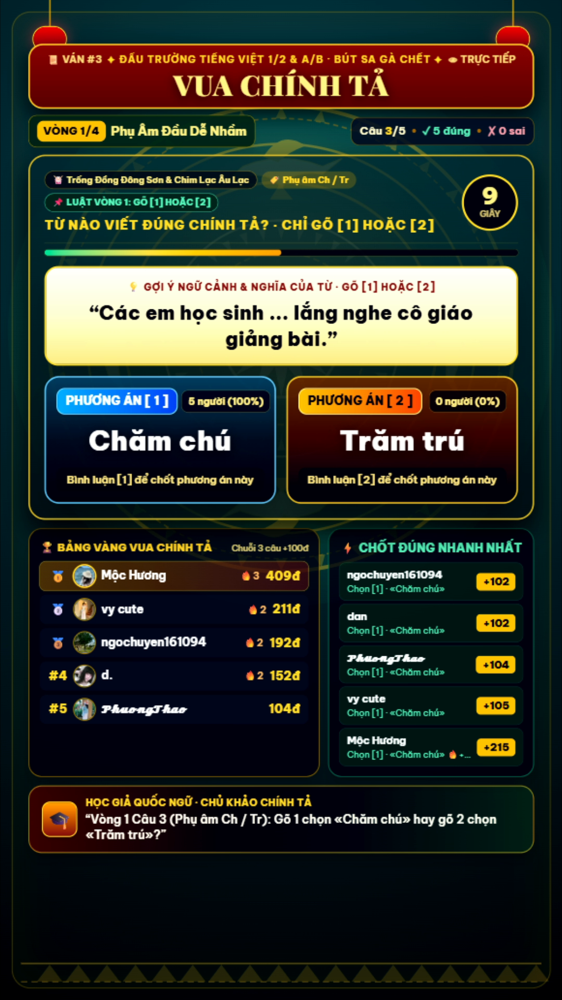 | 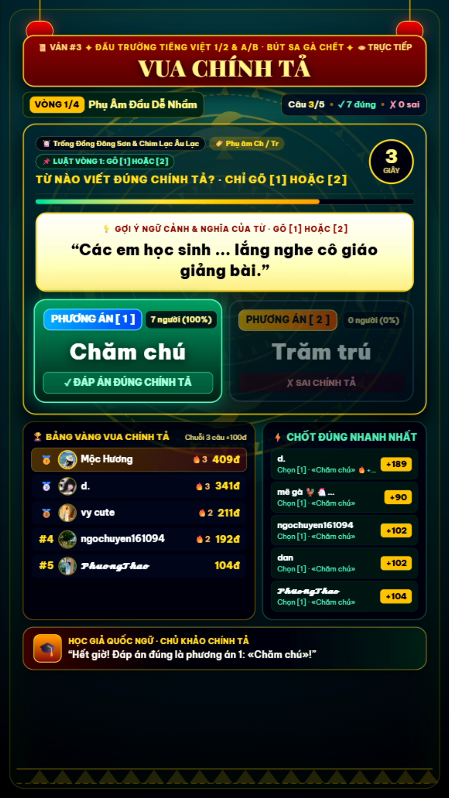 | 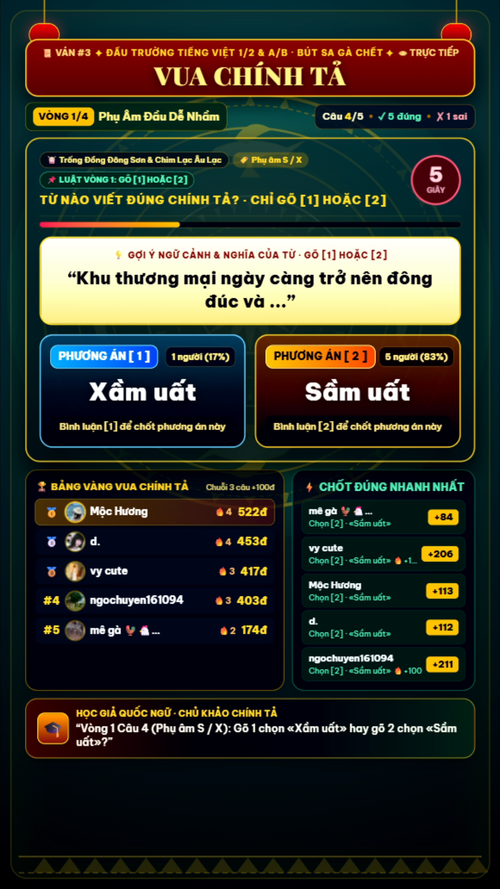 |

### 🏮 B. Chi tiết 4 Vòng Thi (1.550 Câu Hỏi) & Ảnh Chụp Sân Khấu Thực Tế

#### 1. Vòng 1 — Phụ Âm Đầu Dễ Nhầm (`420 câu` · Gõ `[1]` hoặc `[2]` · `🥁 Trống Đồng Đông Sơn`)
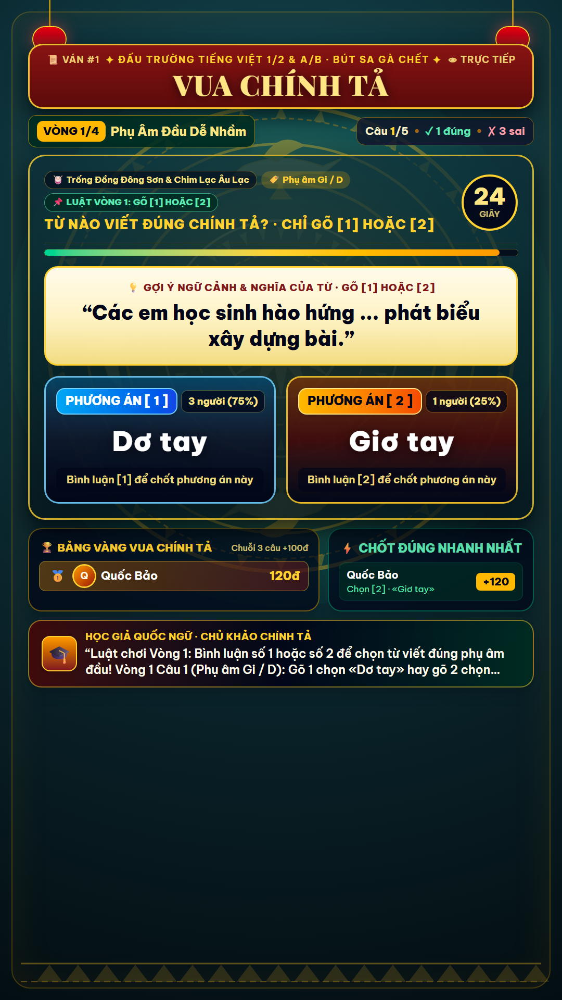
- Phân biệt các cặp phụ âm đầu dễ nhầm nhất: `S / X`, `Ch / Tr`, `D / Gi / R`, `L / N`, `G / Gh`, `Ng / Ngh`, `V / D` (*Chăm chú / Trăm trú*, *Sầm uất / Xầm uất*, *Xán lạn / Sáng lạng*...). Điểm thưởng: **`50đ – 120đ`** (Mở đáp án `4s`).

#### 2. Vòng 2 — Dấu Hỏi / Ngã & Vần Cuối (`450 câu` · Gõ `[A]` hoặc `[B]` · `🌕 Đêm Rằm Chị Hằng & Hồ Sen`)
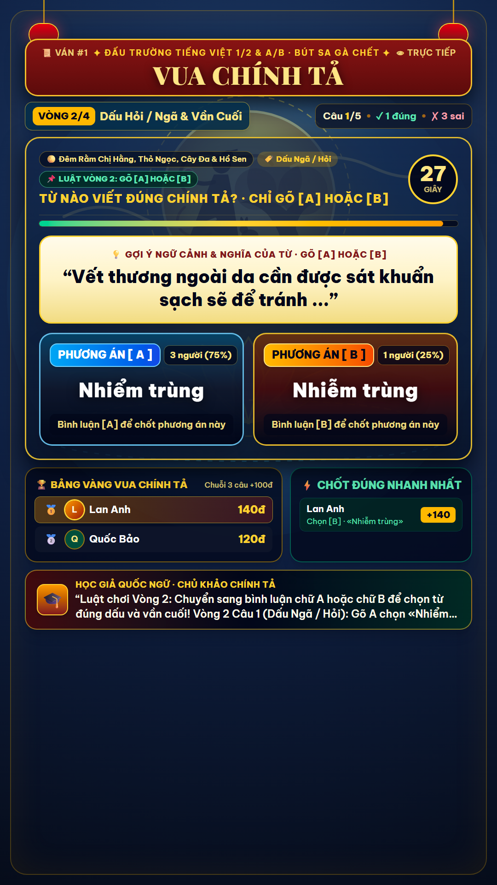
- Bước sang Vòng 2, khán giả chuyển sang gõ **`A`** hoặc **`B`** để phân biệt dấu Hỏi/Ngã (`? / ~`) và các vần cuối dễ viết sai (`c/t`, `n/ng`, `i/y`, `ao/au`, `ai/ay`, `iu/iêu`, `uôn/uân`). Điểm thưởng: **`60đ – 140đ`** (Mở đáp án `4s`).

#### 3. Vòng 3 — Bắt Lỗi Chính Tả Trong Câu (`360 câu` · Gõ `[1]` hoặc `[2]` · `🏛️ Khuê Văn Các · Quốc Tử Giám`)
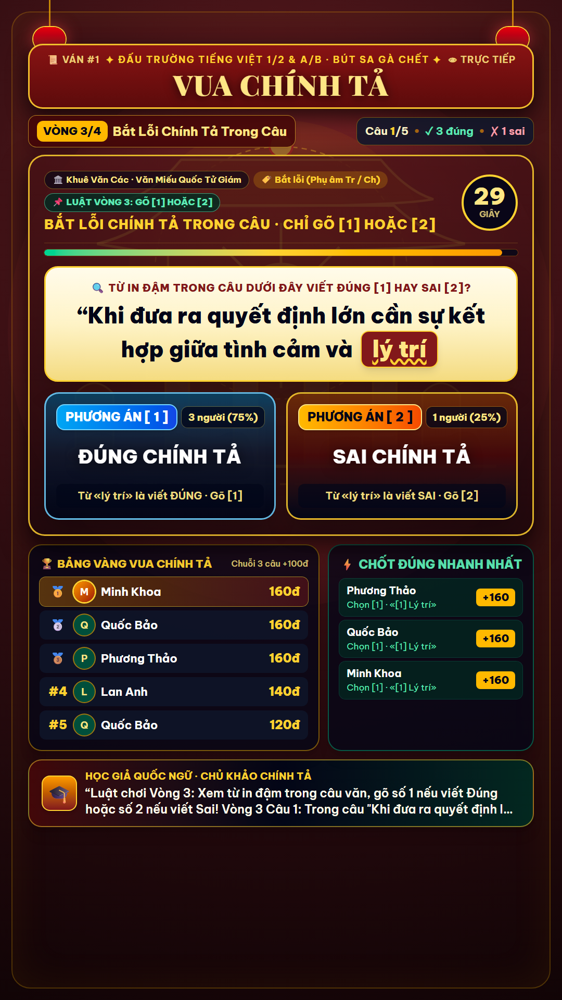
- Khung Cuốn Thư Vàng cỡ chữ lớn (`42px – 44px`) hiển thị một câu văn có từ khóa đóng khung đỏ. Khán giả thẩm định từ in đậm đó viết **ĐÚNG CHÍNH TẢ (`Gõ 1`)** hay **SAI CHÍNH TẢ (`Gõ 2`)**. Điểm thưởng: **`70đ – 160đ`** (Mở đáp án `4.5s` kèm 1 dòng báo từ sửa đúng).

#### 4. Vòng 4 — Phân Tích Từ Thuần Việt & Từ Hán Việt `×2` (`320 câu` · Gõ `[A]` hoặc `[B]` · `🏯 Ngọ Môn Kinh Thành Huế`)
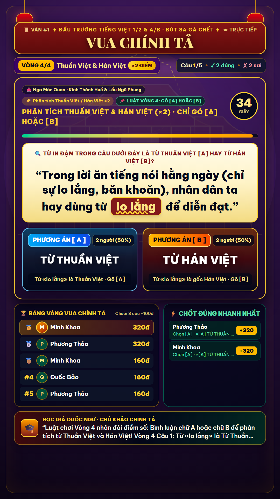
- Vòng quyết chiến **nhân đôi điểm số (`160đ – 320đ`)** kết hợp 2 dạng câu hỏi:
  - **Dạng 4A (`160 câu` — Phân tích từ khóa trong câu văn):** Cho câu văn có từ khóa in đậm (*«xán lạn», «chỉn chu», «bàng hoàng», «khôi ngô»...*), khán giả gõ **`A` (`TỪ THUẦN VIỆT`)** hoặc **`B` (`TỪ HÁN VIỆT`)**.
  - **Dạng 4B (`160 câu` — Đối chiếu cặp từ đồng nghĩa):** Đặt 2 từ đều viết đúng chính tả lên 2 thẻ (*«Thiên địa» vs «Trời đất»*, *«Đàn bà» vs «Phụ nữ»*, *«Sông núi» vs «Giang sơn»*...) và hỏi từ nào là **TỪ THUẦN VIỆT** hoặc từ nào là **TỪ HÁN VIỆT**.
  - Khi mở đáp án (`4s`), MC chốt ngay phương án đúng và màn hình hiện 1 dòng ngang đối chiếu: `✓ Đáp án: «Đàn bà» (Từ Thuần Việt) · «Phụ nữ» (Từ Hán Việt)`.

---

## 4. Bước 4: Chỉnh thời gian đoán bù trễ OBS 5s, Thời gian mở đáp án `4s` & Bàn trộn âm thanh 3 kênh

1. **Bộ chỉnh thời gian 4 vòng & Thời gian mở đáp án (`GameControls`):**
   - Chọn nhanh 1 chạm theo nhịp phòng LIVE:
     - **`⚡ Nhịp Nhanh (12·14·15·18s | Mở ĐA 4s)`**
     - **`🎯 Chuẩn Live TikTok (18·20·22·25s | Mở ĐA 4s — Khuyên dùng)`**
     - **`☕ Thong Thả (25·28·30·35s | Mở ĐA 5s)`**
   - Hoặc tự nhập số giây riêng cho từng vòng **V1..V4** và ô **📖 Mở ĐA** rồi bấm **`Lưu thời gian`**.
2. **Tích hợp sẵn Miễn trừ 5 giây đầu bù trễ OBS & Đồng bộ giọng đọc `Voice-Sync Hold`:**
   - **Miễn trừ 5s trễ OBS (`buTreObsMs: 5000`):** Mọi bình luận đúng gửi trong 5 giây đầu tiên của câu hỏi đều đạt **100% điểm tối đa**, giúp khán giả xem qua sóng OBS bị trễ 4–5 giây không bao giờ bị thiệt điểm.
   - **Đồng bộ giọng đọc `Voice-Sync Hold` + Atomic WAV Header Patching:** Đảm bảo mọi câu nói của Học Giả MC đều được phát trọn vẹn tới chữ cuối cùng.
3. **Bàn trộn âm thanh 3 kênh & Khuếch đại giọng MC `1.55×`:**
   - Chọn giọng đọc AI (**VieNeu AI**, **Microsoft Edge Nam Minh / Hoài My**, hoặc **Google Tiếng Việt**) và điều chỉnh 3 thanh trượt **Nhạc nền**, **Hiệu ứng**, **Giọng MC**.

---

## 5. Bước 5: Quản lý dữ liệu Bảng Vàng Tuần, Lịch sử 1.550 câu hỏi & Sao lưu

- **`settings.json`**: Lưu cấu hình tên kênh, tiêu đề hoành phi, danh xưng MC, thời gian 4 vòng, thời gian mở đáp án và âm lượng.
- **`data/da-hoi.json`**: Lưu vết lịch sử câu hỏi đã xuất hiện trong kho **1.550 câu** để ưu tiên bốc câu mới hoàn toàn ở các ván tiếp theo.
- **`data/bang-tuan.json`**: Lưu Bảng Vàng Tuần tích lũy điểm của các sĩ tử xuyên suốt các buổi phát sóng trong tuần.

---

## 6. Bước 6: Mẹo tối ưu tương tác Follow tự động & Xử lý sự cố thường gặp

- **Hệ thống 4 điểm chạm kêu gọi Follow tự động:**
  1. Khi khán giả bấm Follow trên LIVE: MC đọc tên cảm ơn trực tiếp và mời cả phòng bấm Follow (cooldown `12s`).
  2. Khi phòng im ắng: Cứ mỗi `~35–40 giây` MC tự động nhắc nhẹ khán giả mới vào bấm Follow để lưu điểm Bảng Vàng Tuần.
  3. Khi chuyển vòng (`round_board`) và lễ đăng quang (`podium`): MC kêu gọi bấm Follow trước khi bước vào vòng mới / ván mới.
  4. Nút bấm 1 chạm trên Admin: Bấm **`➕ MC kêu gọi Follow ngay`** bất cứ lúc nào phòng đông mắt xem.
- **Mở khóa âm thanh trình duyệt:** Nếu trình duyệt chặn tự phát tiếng, bấm 1 lần vào nút vàng **`🔊 Chạm 1 lần để bật âm thanh đấu trường`** trên màn hình Stage.

---

# 🇬🇧 PART B — ENGLISH USER GUIDE (STEP-BY-STEP)

## Step 1: Installation on Windows, macOS, and Linux (Port 4016)
- **Windows 10/11 (64-bit):** Download and run [`release/Vua-Chinh-Ta-Setup-v1.0.exe`](https://github.com/duongbirken2510/LIVE-CHINHTA-TIKTOK/releases/latest) (or run `Vua-Chinh-Ta.exe` / `BAT-LIVE.bat`). If Windows SmartScreen appears, click **More info** ➔ **Run anyway**.
- **macOS & Linux:** Run `npm install && npm run dev` (requires Node.js `v20+`).
- **Graceful Shutdown:** Click the red **`🔌 Tắt Live & Giải phóng Port 4016`** button on the Admin Dashboard or run `TAT-LIVE.bat`.

## Step 2: Initial Setup & Adding the 1080×1920 Stage to TikTok LIVE Studio / OBS

- Copy the Stage URL **`http://lvh.me:4016/?view=stage`** from the Admin Dashboard and add it as a **Browser Source (`1080 × 1920`)** in TikTok LIVE Studio or OBS Studio.
- Enter your live TikTok `@username` on the Admin Dashboard and click **`Kết nối`**.

## Step 3: Per-Round Gameplay (`1/2` & `A/B`), Fast `4s` Reveal & 1,550-Question Bank

- **Rounds 1 & 3 (`[1]` vs `[2]`):** Viewers comment `1` or `2` (initial consonants in Round 1; sentence error detection in Round 3).
- **Rounds 2 & 4 (`[A]` vs `[B]`):** Viewers comment `A` or `B` (tones & rimes in Round 2; Sino-Vietnamese vs Native Vietnamese analysis with `×2` double points in Round 4).
- **Fast `4s` Answer Reveal & 5s OBS Grace Window:** Every question reveals its answer in a snappy `4 seconds` without long dictionary lectures, while answers submitted within the first 5 seconds receive 100% maximum speed points to compensate for OBS stream latency.
- **16 Rotating Scholarly Praises & Voice-Sync Hold:** First-blood solvers are celebrated with 16 varied Vietnamese expressions, backed by Atomic WAV Header Patching and Blob playback for zero mid-sentence audio cutoffs.

## Step 4: Storage Management, Backup & Troubleshooting
- All persistent data is stored locally in `settings.json`, `data/da-hoi.json`, and `data/bang-tuan.json`.
- Run `npm test` and `npm run lint` to execute all 20 automated engine verification tests.

---

## 🎯 Kêu Gọi Hành Động / Call To Action (CTA)

<div align="center">
  <a href="https://github.com/duongbirken2510/LIVE-CHINHTA-TIKTOK/releases/latest">
    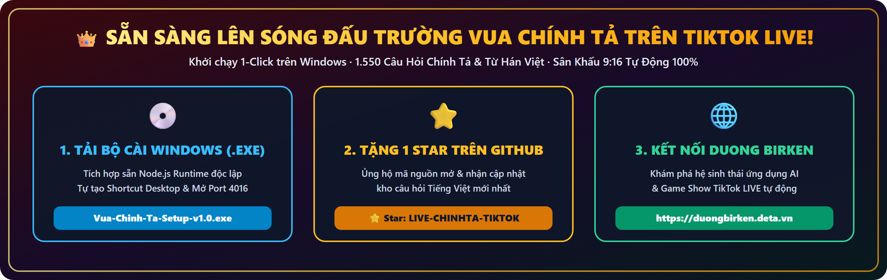
  </a>
  <br /><br />
  <h3>
    💿 <a href="https://github.com/duongbirken2510/LIVE-CHINHTA-TIKTOK/releases/latest"><b>[1. TẢI NGAY BỘ CÀI WINDOWS 1-CLICK (.EXE)]</b></a>
    &nbsp;·&nbsp;
    ⭐ <a href="https://github.com/duongbirken2510/LIVE-CHINHTA-TIKTOK"><b>[2. TẶNG 1 STAR TRÊN GITHUB]</b></a>
    &nbsp;·&nbsp;
    🌐 <a href="https://duongbirken.deta.vn"><b>[3. GHÉ THĂM DUONGBIRKEN.DETA.VN]</b></a>
  </h3>
</div>

---

## 👨‍💻 Tác Giả & Liên Hệ / Author & Contact

| 🇻🇳 Lời nhắn từ Tác giả | 🇬🇧 Note from the Author |
| :--- | :--- |
| **Vua Chính Tả (`LIVE-CHINHTA-TIKTOK`)** là dự án tâm huyết được phát triển bởi **Duong Birken**. Nếu dự án hữu ích với bạn, hãy tặng một ngôi sao (**⭐ Star**) trên GitHub hoặc ghé thăm website chính thức để kết nối và góp ý nhé! | **Vua Chính Tả (`LIVE-CHINHTA-TIKTOK`)** is crafted with passion by **Duong Birken**. If you find this project helpful, please consider giving it a **⭐ Star** on GitHub or visiting the official website to connect and share your feedback! |

- **🌐 Website chính thức & Liên hệ tác giả:** [**https://duongbirken.deta.vn**](https://duongbirken.deta.vn)
- **🐙 GitHub Profile:** [**https://github.com/duongbirken2510**](https://github.com/duongbirken2510)
- **📦 Kho mã nguồn dự án:** [**https://github.com/duongbirken2510/LIVE-CHINHTA-TIKTOK**](https://github.com/duongbirken2510/LIVE-CHINHTA-TIKTOK)
