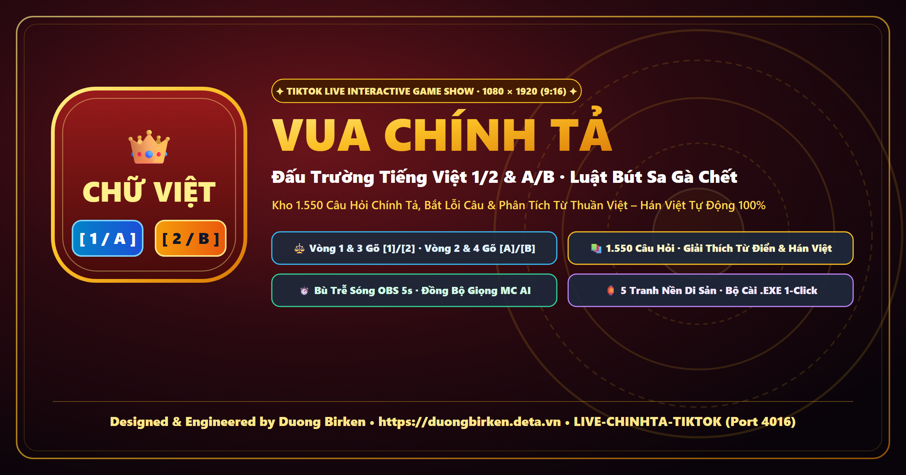
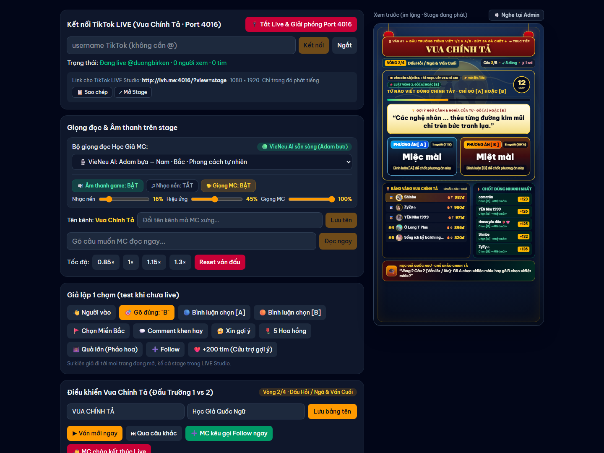
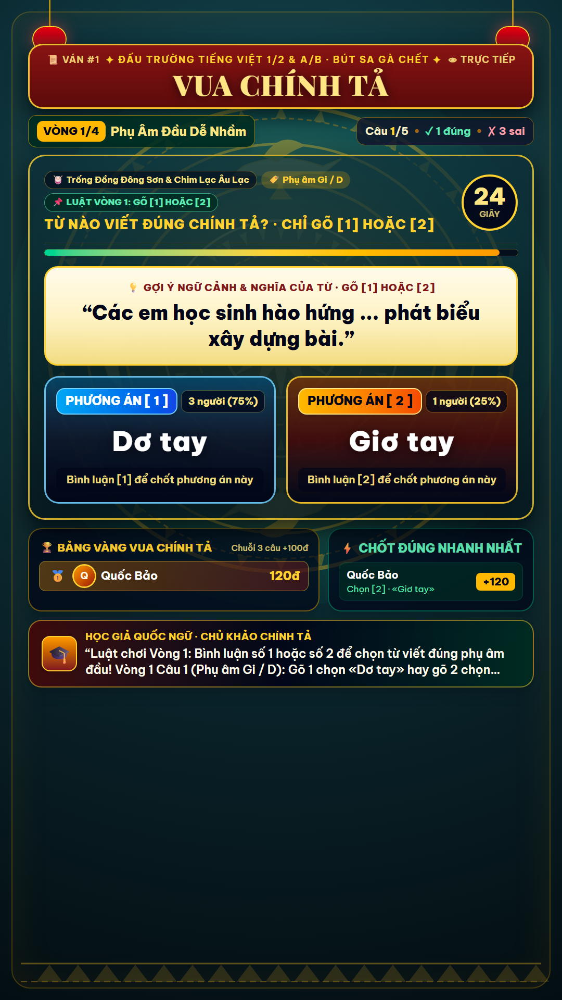
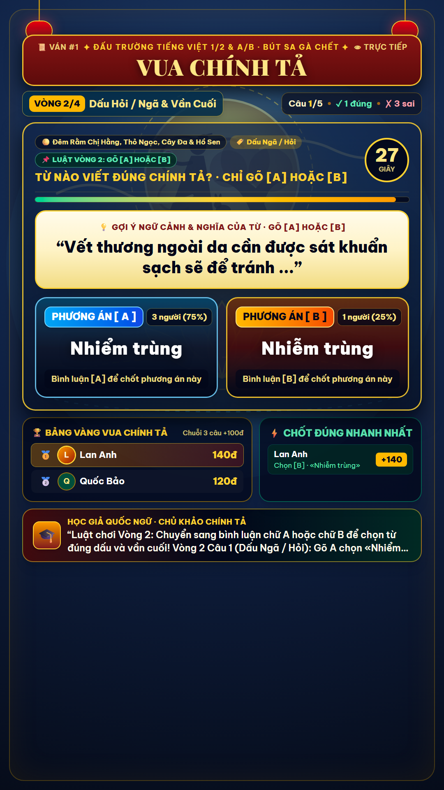
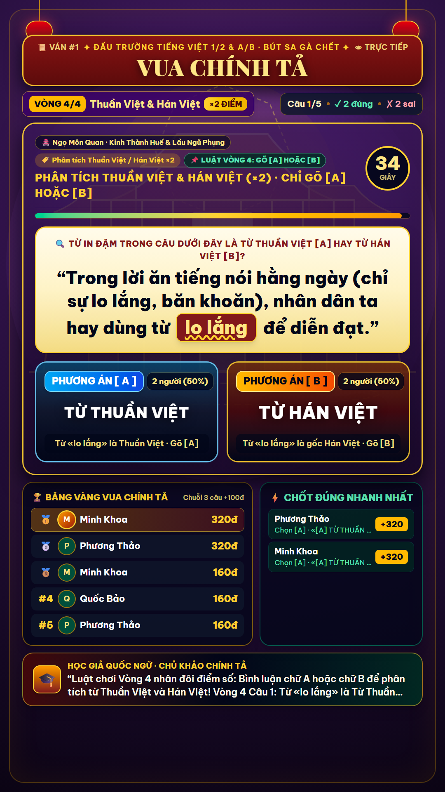

# 👑 HỒ SƠ GIỚI THIỆU SẢN PHẨM & CÔNG NGHỆ: VUA CHÍNH TẢ (`LIVE-CHINHTA-TIKTOK` v1.0.0)

  
    
  <h3>
    💿 👉 <a href="https://github.com/duongbirken2510/LIVE-CHINHTA-TIKTOK/releases/latest"><b>[TẢI NGAY BỘ CÀI ĐẶT WINDOWS 1-CLICK (.EXE)]</b></a> 👈
  </h3>

> **Khẩu hiệu (Tagline):** *"Đấu Trường Chính Tả & Từ Vựng Tiếng Việt Siêu Tốc 1 Chạm (Vòng 1 & 3 Gõ 1/2 · Vòng 2 & 4 Gõ A/B) · Luật Bút Sa Gà Chết · Kho 1.550 Câu Hỏi & Phân Tích Thuần Việt – Hán Việt Tự Động 100% Cho TikTok LIVE"*  
> **Nền tảng hỗ trợ:** Windows 10/11 · macOS · Linux (Node.js + Express + React 19 + Tailwind CSS v4 + Vite 6 + TikTok LIVE Studio / OBS `1080 × 1920`)  
> **Cổng vận hành mặc định:** `http://localhost:4016` (Admin) · `http://lvh.me:4016/?view=stage` (Sân khấu TikTok LIVE Studio `9:16`) · Vite HMR `24686`  
> **Tác giả & Website chính thức:** **Duong Birken** — [https://duongbirken.deta.vn](https://duongbirken.deta.vn)  
> **Kho mã nguồn & Tải về:** [https://github.com/duongbirken2510/LIVE-CHINHTA-TIKTOK](https://github.com/duongbirken2510/LIVE-CHINHTA-TIKTOK) · [`../DOWNLOAD_APP.md`](../DOWNLOAD_APP.md)  
> **Cẩm nang Hướng dẫn Sử dụng A–Z:** [`../docs/USER_GUIDE.md`](../docs/USER_GUIDE.md)

---

## 📑 Mục Lục Nhanh
1. [Vua Chính Tả (`LIVE-CHINHTA-TIKTOK`) là gì?](#1-vua-chính-tả-live-chinhta-tiktok-là-gì)
2. [Các Tính Năng Chính Cung Cấp Cho Người Dùng](#2-các-tính-năng-chính-cung-cấp-cho-người-dùng)
3. [Lợi Ích Mang Lại — Giải Quyết Triệt Để Những "Nỗi Đau" Gì?](#3-lợi-ích-mang-lại--giải-quyết-triệt-để-những-nỗi-đau-gì)
4. [Kịch Bản Thực Tế: Một Phiên Livestream Tiêu Biểu (`A Day in the Life`)](#4-kịch-bản-thực-tế-một-phiên-livestream-tiêu-biểu-a-day-in-the-life)
5. [Kỹ Thuật & Công Nghệ Chuyên Sâu Bên Dưới](#5-kỹ-thuật--công-nghệ-chuyên-sâu-bên-dưới)
6. [Hiệu Quả Công Nghệ & Trải Nghiệm Người Dùng](#6-hiệu-quả-công-nghệ--trải-nghiệm-người-dùng)
7. [Cam Kết An Toàn Chính Sách TikTok LIVE & Quyền Riêng Tư](#7-cam-kết-an-toàn-chính-sách-tiktok-live--quyền-riêng-tư)
8. [Thư Viện Hình Ảnh Giao Diện & Bối Cảnh Di Sản Văn Hóa 4 Vòng](#8-thư-viện-hình-ảnh-giao-diện--bối-cảnh-di-sản-văn-hóa-4-vòng)
9. [Cấu Hình Yêu Cầu & Câu Hỏi Thường Gặp (FAQ)](#9-cấu-hình-yêu-cầu--câu-hỏi-thường-gặp-faq)
10. [Lộ Trình Phát Triển Tiếp Theo & Liên Hệ Tác Giả](#10-lộ-trình-phát-triển-tiếp-theo--liên-hệ-tác-giả)

---

## 1. Vua Chính Tả (`LIVE-CHINHTA-TIKTOK`) là gì?

**Vua Chính Tả — Đấu Trường Tiếng Việt 1/2 & A/B (`LIVE-CHINHTA-TIKTOK`)** là hệ thống **Game Show Tương Tác Chính Tả & Từ Vựng Tiếng Việt Siêu Tốc 1 Chạm** vận hành tự động 100% theo thời gian thực dành riêng cho các nhà sáng tạo nội dung trên **TikTok LIVE** (`1080 × 1920`, dọc `9:16`).

- **Tương tác 1 chạm thông minh phân theo vòng (`[1]/[2]` ở Vòng 1 & 3 · `[A]/[B]` ở Vòng 2 & 4):** Khán giả chỉ cần gõ `1`/`2` hoặc `A`/`B` theo đúng luật của vòng đang thi (Học Giả MC tự động giới thiệu luật chơi ở đầu mỗi vòng).
- **Luật "Bút Sa Gà Chết" (`lockedChoices`):** Chỉ ghi nhận lựa chọn đầu tiên của mỗi người trong mỗi câu hỏi, chống tuyệt đối hành vi spam cả 2 đáp án.
- **Kho 1.550 câu hỏi độc nhất chia 4 vòng chuyên sâu:** Từ phụ âm đầu (`420 câu`), dấu hỏi/ngã & vần cuối (`450 câu`), bắt lỗi chính tả trong câu (`360 câu`), đến phân tích nguồn gốc **Từ Thuần Việt & Từ Hán Việt `×2` điểm** (`320 câu`).
- **Giao diện Sân Khấu 9:16 Tinh Gọn Cỡ Chữ Lớn (`42px – 52px`):** Tối ưu hóa cho màn hình điện thoại nhỏ với Khung Cuốn Thư Đề Bài cỡ lớn và 2 thẻ phương án 1 hàng duy nhất (`whitespace-nowrap`).

---

## 2. Các Tính Năng Chính Cung Cấp Cho Người Dùng

| Nhóm tính năng | Chi tiết trải nghiệm cung cấp cho người dùng |
| :--- | :--- |
| **1. Cơ Chế `1/2` (Vòng 1, 3) & `A/B` (Vòng 2, 4) + Luật "Bút Sa Gà Chết"** | • Vòng 1 & 3 chỉ nhận `1` hoặc `2`; Vòng 2 & 4 chỉ nhận `A` hoặc `B` — kèm lời giới thiệu luật chơi đầu mỗi vòng của Học Giả MC. • [`ChinhTaEngine`](../src/game/chinhta.ts) khóa chặt lựa chọn đầu tiên trong `lockedChoices: Map<playerId, 1 \| 2>`. Chọn đúng lần đầu được cộng điểm tốc độ và thưởng chuỗi 3 câu (`+100đ`). Chọn sai lần đầu bị cắt chuỗi thắng và khóa câu đó (`locked_wrong`). |
| **2. Kho Đề Khủng 1.550 Câu Hỏi & Vòng 4 Phân Tích Thuần Việt – Hán Việt `×2`** | • **Vòng 1 (`420 câu`):** Phụ âm đầu dễ nhầm (`S/X, Ch/Tr, D/Gi/R, L/N, G/Gh, Ng/Ngh, V/D`). • **Vòng 2 (`450 câu`):** Dấu Hỏi/Ngã & Vần cuối (`?/~, c/t, n/ng, i/y, ao/au, ai/ay, iu/iêu, uôn/uân`). • **Vòng 3 (`360 câu`):** Bắt lỗi từ in đậm trong câu văn (`[1] ĐÚNG CHÍNH TẢ` vs `[2] SAI CHÍNH TẢ`). • **Vòng 4 (`320 câu · ×2 Điểm`):** Kết hợp `160 câu Dạng 4A` (Phân tích từ in đậm trong câu là `TỪ THUẦN VIỆT` hay `TỪ HÁN VIỆT`) + `160 câu Dạng 4B` (Đối chiếu 2 từ đồng nghĩa tìm từ Thuần Việt / Hán Việt). |
| **3. Miễn Trừ 5s Trễ Sóng OBS & Đồng Bộ Giọng Đọc `Voice-Sync Hold`** | • **Bù trễ OBS 5 giây (`buTreObsMs: 5000`):** Người xem trên điện thoại bị trễ hình ảnh OBS 4–5 giây trả lời ngay khi thấy đề vẫn đạt **100% điểm tối đa**. • **Đồng bộ giọng đọc `Voice-Sync Hold`:** Hệ thống tự động co giãn thời gian Mở Đáp Án & Chuyển Vòng theo số từ và số dấu câu, đồng thời giữ cảnh đợi Học Giả MC đọc dứt chữ cuối cùng (+`0.45s` nghỉ lấy hơi) rồi mới chuyển cảnh. |
| **4. 5 Bức Tranh Nền Di Sản Văn Hóa Việt Nam Theo Từng Vòng** | • [`StageBackgroundArtwork`](../src/game/GameStage.tsx) tự động đổi màu nền và họa tiết SVG di sản:   - **Vòng 1:** 🥁 *Trống Đồng Đông Sơn & Chim Lạc Âu Lạc*   - **Vòng 2:** 🌕 *Đêm Rằm Chị Hằng, Thỏ Ngọc, Cây Đa & Hồ Sen*   - **Vòng 3:** 🏛️ *Khuê Văn Các · Văn Miếu Quốc Tử Giám*   - **Vòng 4:** 🏯 *Ngọ Môn Quan · Kinh Thành Huế & Lầu Ngũ Phụng*   - **Chuyển Vòng & Đăng Quang:** 👑 *Điện Thái Hòa · Vinh Quy Bái Tổ* |
| **5. Hệ Thống 4 Điểm Chạm Kêu Gọi Follow & Bàn Trộn Âm Thanh 3 Kênh** | • Tự động cảm ơn khi có người Follow, nhắc Follow khi phòng im ắng, nhắc Follow lúc chuyển vòng / đăng quang và có nút **`➕ MC kêu gọi Follow ngay`** trên Admin. • Tích hợp **VieNeu-TTS AI**, **Microsoft Edge Neural TTS** và **Google TTS** với Pre-Ducking 95% và Voice Boost `1.55×`. |

---

## 3. Lợi Ích Mang Lại — Giải Quyết Triệt Để Những "Nỗi Đau" Gì?

1. **Giải quyết nỗi đau "Khán giả bị trễ sóng OBS 5 giây dẫn tới mất điểm tốc độ hoặc trôi đáp án sang vòng sau":**
   - *Giải pháp của Vua Chính Tả:* Miễn trừ trọn vẹn `5.000ms` đầu mỗi câu hỏi trong công thức chấm điểm tốc độ (`effectiveElapsed = Math.max(0, rawElapsed - graceMs)`), kết hợp đổi bộ ký hiệu bình luận theo vòng (`1/2` ở Vòng 1, 3 và `A/B` ở Vòng 2, 4).
2. **Giải quyết nỗi đau "MC đang đọc giải thích đáp án hoặc giới thiệu vòng mới chưa hết câu đã bị cắt ngang chuyển cảnh":**
   - *Giải pháp của Vua Chính Tả:* Thuật toán `computeSpeechDurationMs()` tính chính xác tốc độ đọc tiếng Việt (`2.85 từ/giây` + `0.32s` mỗi dấu câu) kết hợp cơ chế `Voice-Sync Hold` trong `tick(now, holdForVoice)` giữ cảnh đợi `voice.busy === false` và khóa chèn thoại phụ ở 5 giây cuối câu hỏi.
3. **Giải quyết nỗi đau "Chữ câu hỏi trên màn hình dọc 9:16 bị nhỏ hoặc chữ `ĐÚNG CHÍNH TẢ` bị rớt xuống 2 dòng":**
   - *Giải pháp của Vua Chính Tả:* Lược bỏ hoàn toàn các thanh phụ rườm rà để phóng to Khung Cuốn Thư Đề Bài lên cỡ chữ `38px – 44px`, đồng thời khóa cứng `whitespace-nowrap` kết hợp co cỡ chữ thông minh trên 2 thẻ phương án.

---

## 4. Kịch Bản Thực Tế: Một Phiên Livestream Tiêu Biểu (`A Day in the Life`)

| Thời điểm / Bước | Tình huống thực tế của Chủ kênh (Host) | Cách Vua Chính Tả phản hồi thông minh |
| :--- | :--- | :--- |
| **Bước 1: Mở sân khấu (5 giây)** | Chủ kênh nhấp đúp file `BAT-LIVE.bat` hoặc `Vua-Chinh-Ta.exe`. | Server khởi chạy trên cổng `4016`, mở trang Admin `http://localhost:4016` và cấp nguồn hình `1080 × 1920` tại `http://lvh.me:4016/?view=stage`. |
| **Bước 2: Kết nối & Chọn nhịp độ** | Chủ kênh mở TikTok LIVE Studio, nhập `@username` vào Admin và chọn **🎯 Chuẩn Live TikTok (`18·20·22·25s | Mở ĐA 9s`)**. | `TikTokLiveConnection` bắt sóng phòng live, nạp trước (`prefetch`) giọng đọc MC cho câu hiện tại và lời giải thích mở đáp án. |
| **Bước 3: Tranh tài 4 vòng (`1/2` & `A/B`)** | Đầu mỗi vòng, Học Giả MC giới thiệu luật chơi (`1/2` hoặc `A/B`). Hàng trăm khán giả bình luận chốt đáp án. | Luật Bút Sa Gà Chết khóa lựa chọn đầu tiên; ai trả lời trong 5s đầu đều đạt 100% điểm tối đa bù trễ OBS. |
| **Bước 4: Giải thích & Đăng quang** | Hết giờ mỗi câu hoặc khép lại 20 câu của 4 vòng. | Hộp **📖 Giải thích từ điển / Phân tích Thuần Việt & Hán Việt** bật sáng; hệ thống đợi MC đọc dứt chữ cuối mới chuyển câu. |

---

## 5. Kỹ Thuật & Công Nghệ Chuyên Sâu Bên Dưới

- **Bộ phân tích lựa chọn theo chế độ vòng ([`src/game/compare.ts`](../src/game/compare.ts)):** Hàm `parsePlayerChoice(raw, option1Text, option2Text, extraAliases, mode: '12' | 'AB')` chuẩn hóa dấu tiếng Việt (`oà ↔ òa`, `uý ↔ úy`), cắt tiểu từ lịch sự cuối câu (`"B ạ"` -> phương án `B`), chặn bình luận nước đôi (`"1 2"`, `"A hay B"`) và tách biệt hoàn toàn chế độ `'12'` với `'AB'`.
- **Máy trạng thái Game & Đồng bộ giọng đọc ([`src/game/chinhta.ts`](../src/game/chinhta.ts), [`src/game/useGame.ts`](../src/game/useGame.ts)):** Quản lý kho 1.550 câu hỏi chia tách thành 4 chunk dữ liệu độc lập ([`kho-vong-1.ts`](../src/game/kho-vong-1.ts) .. [`kho-vong-4.ts`](../src/game/kho-vong-4.ts)), tính điểm bù trễ OBS `buTreObsMs: 5000`, và đồng bộ `tick(now, holdForVoice)`.
- **Bàn trộn âm thanh WebAudio 3 kênh ([`src/game/sfx.ts`](../src/game/sfx.ts), [`src/live/voice.ts`](../src/live/voice.ts)):** Tổng hợp nhạc nền ngũ cung không bản quyền, Pre-Ducking 95% và Voice Boost `1.55×`.

---

## 6. Hiệu Quả Công Nghệ & Trải Nghiệm Người Dùng

| Tiêu chí đánh giá | Game đố chữ truyền thống | Hiệu quả thực tế trên **Vua Chính Tả (`LIVE-CHINHTA-TIKTOK`)** |
| :--- | :--- | :--- |
| **Quy mô kho câu hỏi** | Vài chục câu lặp đi lặp lại | **1.550 câu hỏi độc nhất (`420 + 450 + 360 + 320`) lưu vết không trùng** |
| **Chống trôi đáp án do trễ OBS** | Dễ bị tính nhầm đáp án câu cũ sang câu mới | **Phân tách `1/2` (Vòng 1, 3) & `A/B` (Vòng 2, 4) + Miễn trừ 5s đầu bù trễ OBS** |
| **Đồng bộ giọng đọc MC** | Hết giờ là cắt ngang câu MC đang nói | **`Voice-Sync Hold` đợi MC đọc dứt câu (+`0.45s`) mới chuyển cảnh** |
| **Hiển thị trên điện thoại nhỏ** | Nhiều thanh phụ rối mắt, chữ rớt dòng | **Cuốn thư đề bài chữ lớn `42px – 44px` & 2 thẻ phương án 1 hàng duy nhất** |

---

## 7. Cam Kết An Toàn Chính Sách TikTok LIVE & Quyền Riêng Tư

- **Tuân thủ 100% chính sách TikTok LIVE:** Bộ lọc [`bannedWords.ts`](../src/live/bannedWords.ts) chặn từ ngữ nhạy cảm; quà tặng chỉ hiện **Banner Pháo Hoa Vinh Quy** tri ân, tuyệt đối không mua điểm.
- **Bảo mật Localhost-Only:** Server Express trên cổng `4016` chỉ lắng nghe trên `127.0.0.1` (`localhost` và `lvh.me`).

---

## 8. Thư Viện Hình Ảnh Giao Diện & Bối Cảnh Di Sản Văn Hóa 4 Vòng

### 🖥️ Giao Diện Quản Trị Admin (`http://localhost:4016`)

### 📱 Sân Khấu 4 Vòng Thi (`1080 × 1920` · Dọc `9:16`)
| Vòng 1: Phụ Âm Đầu (`Gõ [1] / [2]`) | Vòng 2: Dấu Hỏi/Ngã & Vần Cuối (`Gõ [A] / [B]`) |
| :---: | :---: |
|  |  |
| **Vòng 3: Bắt Lỗi Trong Câu (`Gõ [1] / [2]`)** | **Vòng 4: Thuần Việt & Hán Việt `×2` (`Gõ [A] / [B]`)** |
|  |  |

---

## 9. Cấu Hình Yêu Cầu & Câu Hỏi Thường Gặp (FAQ)

- **Hệ điều hành:** Windows 10/11 (64-bit), macOS 12+, hoặc Linux.
- **Cổng hệ thống:** Port `4016` (HTTP/SSE Admin & Stage) và Port `24686` (Vite HMR).
- **Câu hỏi thường gặp:**
  - *Gắn link nào vào TikTok LIVE Studio?* → Dán `http://lvh.me:4016/?view=stage` với kích thước `1080 × 1920`.
  - *Làm sao tắt hoàn toàn Server và giải phóng cổng 4016?* → Bấm nút đỏ **🔌 Tắt Live & Giải phóng Port 4016** trên đỉnh trang Admin hoặc chạy `TAT-LIVE.bat`.

---

## 10. Lộ Trình Phát Triển Tiếp Theo & Liên Hệ Tác Giả

### 🚀 Lộ Trình Các Phiên Bản Tiếp Theo (`Roadmap`)
- Bổ sung trình quản lý và nhập/xuất bộ câu hỏi tùy chỉnh (`.csv` / `.json`) trực tiếp trên giao diện Admin.
- Mở rộng thêm chủ đề Từ cổ Tiếng Việt & Điển tích Văn học.

### 🎯 Kêu Gọi Hành Động / Call To Action (CTA)

  
    
  <h3>
    💿 <a href="https://github.com/duongbirken2510/LIVE-CHINHTA-TIKTOK/releases/latest"><b>[1. TẢI NGAY BỘ CÀI WINDOWS 1-CLICK (.EXE)]</b></a>
    &nbsp;·&nbsp;
    ⭐ <a href="https://github.com/duongbirken2510/LIVE-CHINHTA-TIKTOK"><b>[2. TẶNG 1 STAR TRÊN GITHUB]</b></a>
    &nbsp;·&nbsp;
    🌐 <a href="https://duongbirken.deta.vn"><b>[3. GHÉ THĂM DUONGBIRKEN.DETA.VN]</b></a>
  </h3>

### 👨‍💻 Tác Giả & Liên Hệ / Author & Contact

| 🇻🇳 Lời nhắn từ Tác giả | 🇬🇧 Note from the Author |
| :--- | :--- |
| **Vua Chính Tả (`LIVE-CHINHTA-TIKTOK`)** là dự án tâm huyết được phát triển bởi **Duong Birken**. Nếu dự án hữu ích với bạn, hãy tặng một ngôi sao (**⭐ Star**) trên GitHub hoặc ghé thăm website chính thức để kết nối và góp ý thêm nhé! | **Vua Chính Tả (`LIVE-CHINHTA-TIKTOK`)** is crafted with passion by **Duong Birken**. If you find this project helpful, please consider giving it a **⭐ Star** on GitHub or visiting the official website to connect and share your feedback! |

- **🌐 Website chính thức & Liên hệ tác giả:** [**https://duongbirken.deta.vn**](https://duongbirken.deta.vn)
- **📦 Kho mã nguồn:** [**https://github.com/duongbirken2510/LIVE-CHINHTA-TIKTOK**](https://github.com/duongbirken2510/LIVE-CHINHTA-TIKTOK)
