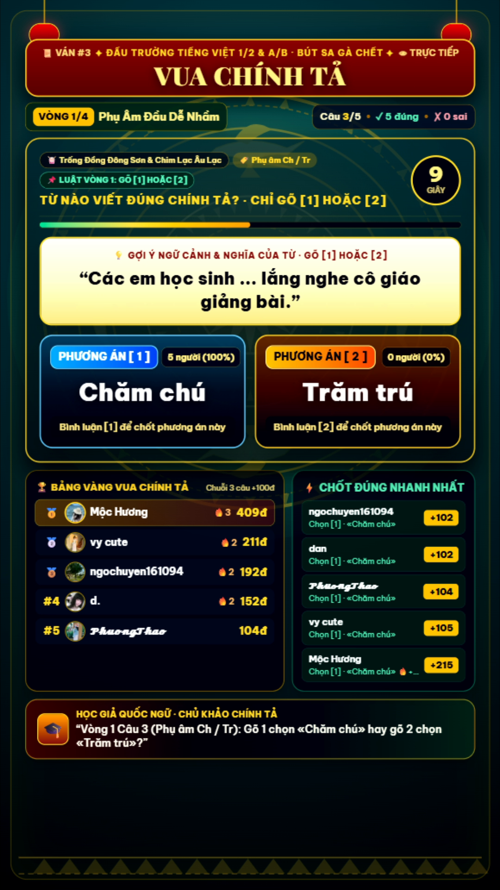
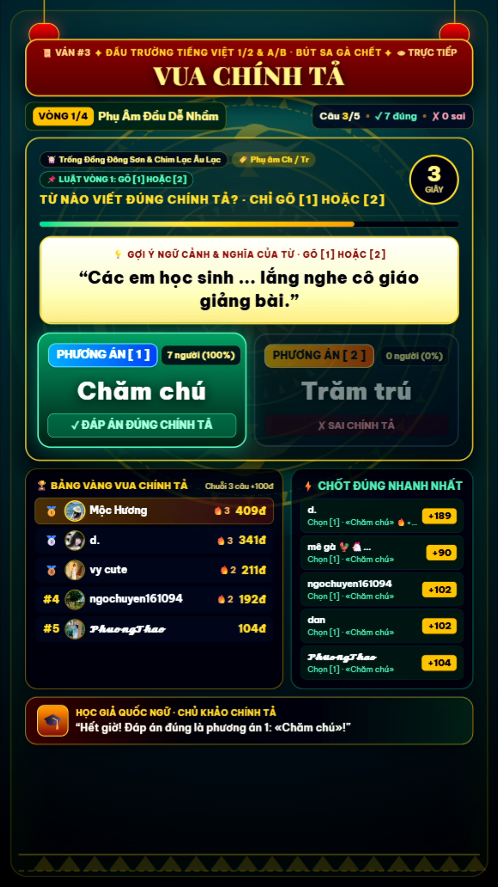
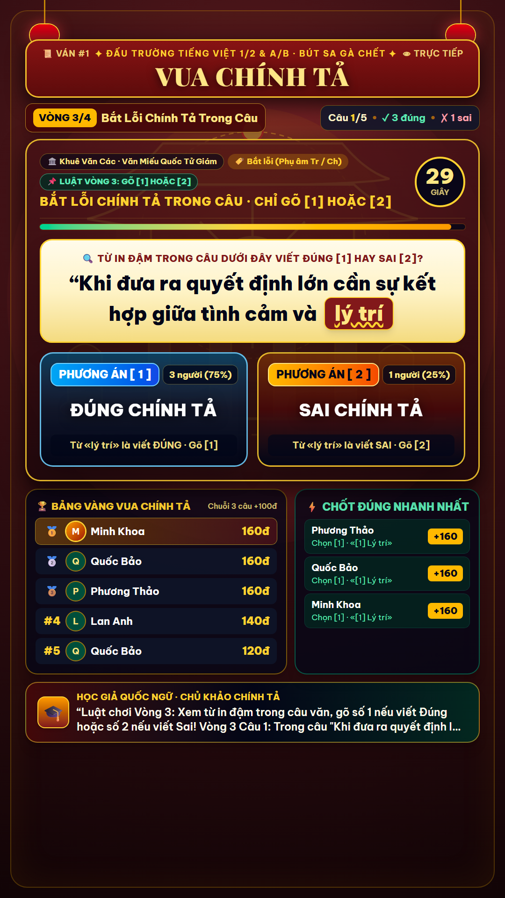
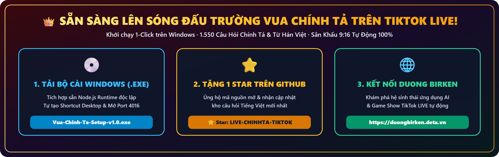

# 👑 HỒ SƠ GIỚI THIỆU SẢN PHẨM & CÔNG NGHỆ: VUA CHÍNH TẢ (`LIVE-CHINHTA-TIKTOK` v1.0.0)

  
    
  <h3>
    💿 👉 <a href="https://github.com/duongbirken2510/LIVE-CHINHTA-TIKTOK/releases/latest"><b>[TẢI NGAY BỘ CÀI ĐẶT WINDOWS 1-CLICK (.EXE)]</b></a> 👈
    &nbsp;·&nbsp;
    🎬 👉 <a href="../Record_2026-vua-chinh-ta.mp4"><b>[XEM VIDEO PHÒNG LIVE THỰC TẾ (.MP4)]</b></a> 👈
  </h3>

> **Khẩu hiệu (Tagline):** *"Đấu Trường Chính Tả & Từ Vựng Tiếng Việt Siêu Tốc 1 Chạm (Vòng 1 & 3 Gõ 1/2 · Vòng 2 & 4 Gõ A/B) · Luật Bút Sa Gà Chết · Mở Đáp Án 4 Giây · Kho 1.550 Câu Hỏi & Phân Tích Thuần Việt – Hán Việt Tự Động 100% Cho TikTok LIVE"*  
> **Nền tảng hỗ trợ:** Windows 10/11 · macOS · Linux (Node.js + Express + React 19 + Tailwind CSS v4 + Vite 6 + TikTok LIVE Studio / OBS `1080 × 1920`)  
> **Cổng vận hành mặc định:** `http://localhost:4016` (Admin) · `http://lvh.me:4016/?view=stage` (Sân khấu TikTok LIVE Studio `9:16`) · Vite HMR `24686`  
> **Tác giả & Website chính thức:** **Duong Birken** — [https://duongbirken.deta.vn](https://duongbirken.deta.vn)  
> **Kho mã nguồn & Tải về:** [https://github.com/duongbirken2510/LIVE-CHINHTA-TIKTOK](https://github.com/duongbirken2510/LIVE-CHINHTA-TIKTOK) · [`../DOWNLOAD_APP.md`](../DOWNLOAD_APP.md)  
> **Cẩm nang Hướng dẫn Sử dụng A–Z:** [`../docs/USER_GUIDE.md`](../docs/USER_GUIDE.md)  
> **Video Bản Ghi Phòng LIVE Thực Tế:** [`../Record_2026-vua-chinh-ta.mp4`](../Record_2026-vua-chinh-ta.mp4)

---

## 📑 Mục Lục Nhanh
1. [Vua Chính Tả (`LIVE-CHINHTA-TIKTOK`) là gì?](#1-vua-chính-tả-live-chinhta-tiktok-là-gì)
2. [Các Tính Năng Chính Cung Cấp Cho Người Dùng](#2-các-tính-năng-chính-cung-cấp-cho-người-dùng)
3. [Lợi Ích Mang Lại — Giải Quyết Triệt Để Những "Nỗi Đau" Gì?](#3-lợi-ích-mang-lại--giải-quyết-triệt-để-những-nỗi-đau-gì)
4. [Kịch Bản Thực Tế: Một Phiên Livestream Tiêu Biểu (`A Day in the Life`)](#4-kịch-bản-thực-tế-một-phiên-livestream-tiêu-biểu-a-day-in-the-life)
5. [Kỹ Thuật & Công Nghệ Chuyên Sâu Bên Dưới](#5-kỹ-thuật--công-nghệ-chuyên-sâu-bên-dưới)
6. [Hiệu Quả Công Nghệ & Trải Nghiệm Người Dùng](#6-hiệu-quả-công-nghệ--trải-nghiệm-người-dùng)
7. [Cam Kết An Toàn Chính Sách TikTok LIVE & Quyền Riêng Tư](#7-cam-kết-an-toàn-chính-sách-tiktok-live--quyền-riêng-tư)
8. [Thư Viện Video Demo Thực Tế (`Record_2026-vua-chinh-ta.mp4`) & Hình Ảnh Giao Diện](#8-thư-viện-video-demo-thực-tế-record_2026-vua-chinh-tamp4--hình-ảnh-giao-diện)
9. [Cấu Hình Yêu Cầu & Câu Hỏi Thường Gặp (FAQ)](#9-cấu-hình-yêu-cầu--câu-hỏi-thường-gặp-faq)
10. [Lộ Trình Phát Triển Tiếp Theo & Liên Hệ Tác Giả](#10-lộ-trình-phát-triển-tiếp-theo--liên-hệ-tác-giả)

---

## 1. Vua Chính Tả (`LIVE-CHINHTA-TIKTOK`) là gì?

**Vua Chính Tả — Đấu Trường Tiếng Việt 1/2 & A/B (`LIVE-CHINHTA-TIKTOK`)** là hệ thống **Game Show Tương Tác Chính Tả & Từ Vựng Tiếng Việt Siêu Tốc 1 Chạm** vận hành tự động 100% theo thời gian thực dành riêng cho các nhà sáng tạo nội dung trên **TikTok LIVE** (`1080 × 1920`, dọc `9:16`).

Sản phẩm được thiết kế xoay quanh 5 trụ cột trải nghiệm đã được kiểm chứng thực chiến trên sóng TikTok LIVE:
- **Tương tác 1 chạm phân tách thông minh theo vòng (`[1]/[2]` ở Vòng 1 & 3 · `[A]/[B]` ở Vòng 2 & 4):** Khán giả chỉ cần gõ `1`/`2` hoặc `A`/`B` theo đúng luật của vòng đang thi. Ngay ở màn hình Chuyển Vòng và Câu 1 của mỗi vòng, Học Giả MC đều giới thiệu rõ luật chơi để người xem bắt nhịp ngay lập tức.
- **Luật "Bút Sa Gà Chết" (`lockedChoices`):** Chỉ ghi nhận lựa chọn đầu tiên của mỗi người trong mỗi câu hỏi, chống tuyệt đối hành vi spam cả 2 đáp án.
- **Nhịp mở đáp án siêu tốc `4 giây` đồng bộ cả 4 vòng:** Không bắt khán giả phải chờ đợi nghe giảng nghĩa từ điển lê thê; ngay khi hết giờ, thẻ đúng sáng rực màu Xanh Lục Bảo, Học Giả MC chốt đáp án gọn gàng trong `3.5 – 4 giây` rồi sang câu mới ngay.
- **Kho 1.550 câu hỏi độc nhất chia 4 vòng chuyên sâu:** Từ phụ âm đầu (`420 câu`), dấu hỏi/ngã & vần cuối (`450 câu`), bắt lỗi chính tả trong câu (`360 câu`), đến phân tích nguồn gốc **Từ Thuần Việt & Từ Hán Việt `×2` điểm** (`320 câu`).
- **Giao diện Sân Khấu 9:16 Tinh Gọn Cỡ Chữ Lớn (`42px – 52px`):** Tối ưu hóa cho màn hình điện thoại nhỏ với Khung Cuốn Thư Đề Bài cỡ lớn và 2 thẻ phương án 1 hàng duy nhất (`whitespace-nowrap`).

---

## 2. Các Tính Năng Chính Cung Cấp Cho Người Dùng

| Nhóm tính năng | Chi tiết trải nghiệm cung cấp cho người dùng |
| :--- | :--- |
| **1. Cơ Chế `1/2` (Vòng 1, 3) & `A/B` (Vòng 2, 4) + Luật "Bút Sa Gà Chết"** | • Vòng 1 & 3 chỉ nhận `1` hoặc `2`; Vòng 2 & 4 chỉ nhận `A` hoặc `B` — kèm lời giới thiệu luật chơi đầu mỗi vòng của Học Giả MC. • [`ChinhTaEngine`](../src/game/chinhta.ts) khóa chặt lựa chọn đầu tiên trong `lockedChoices: Map<playerId, 1 \| 2>`. Chọn đúng lần đầu được cộng điểm tốc độ và thưởng chuỗi 3 câu (`+100đ`). Chọn sai lần đầu bị cắt chuỗi thắng và khóa câu đó (`locked_wrong`). |
| **2. Kho Đề Khủng 1.550 Câu Hỏi & Vòng 4 Phân Tích Thuần Việt – Hán Việt `×2`** | • **Vòng 1 (`420 câu`):** Phụ âm đầu dễ nhầm (`S/X, Ch/Tr, D/Gi/R, L/N, G/Gh, Ng/Ngh, V/D`). • **Vòng 2 (`450 câu`):** Dấu Hỏi/Ngã & Vần cuối (`?/~, c/t, n/ng, i/y, ao/au, ai/ay, iu/iêu, uôn/uân`). • **Vòng 3 (`360 câu`):** Bắt lỗi từ in đậm trong câu văn (`[1] ĐÚNG CHÍNH TẢ` vs `[2] SAI CHÍNH TẢ`). • **Vòng 4 (`320 câu · ×2 Điểm`):** Kết hợp `160 câu Dạng 4A` (Phân tích từ in đậm trong câu là `TỪ THUẦN VIỆT` hay `TỪ HÁN VIỆT`) + `160 câu Dạng 4B` (Đối chiếu 2 từ đồng nghĩa tìm từ Thuần Việt / Hán Việt). |
| **3. Mở Đáp Án Siêu Tốc `4 Giây`, Miễn Trừ 5s Trễ OBS & `Voice-Sync Hold`** | • **Mở đáp án 4 giây (`thoiGianMoDapAnMacDinh: 4`):** Loại bỏ hoàn toàn thời gian chết giữa các câu; Vòng 1 & 2 mở thẻ xanh trong `4s`, Vòng 3 & 4 hiện thêm đúng 1 thanh ngang 1 dòng đối chiếu đáp án. • **Bù trễ OBS 5 giây (`buTreObsMs: 5000`):** Người xem trên điện thoại bị trễ hình ảnh OBS 4–5 giây trả lời ngay khi thấy đề vẫn đạt **100% điểm tối đa**. • **Đồng bộ giọng đọc `Voice-Sync Hold` & Atomic WAV Header Patching:** Đảm bảo giọng Học Giả MC không bao giờ bị ngắt câu giữa chừng. |
| **4. 16 Lời Khen Xoay Vòng & Hệ Thống 4 Điểm Chạm Kêu Gọi Follow** | • Bộ 16 lời khen mở hàng (*"Xuất sắc!"*, *"Chuẩn xác tuyệt đối!"*, *"Mở hàng hồng phát!"*, *"Kiến thức uyên bác!"*, *"Nhãn quan sắc bén!"*...) xoay vòng liên tục. • Tự động cảm ơn khi có người Follow, nhắc Follow khi phòng im ắng, nhắc Follow lúc chuyển vòng / đăng quang và có nút **`➕ MC kêu gọi Follow ngay`** trên Admin. |
| **5. 5 Bức Tranh Nền Di Sản Văn Hóa Việt Nam & Bàn Trộn Âm Thanh 3 Kênh** | • [`StageBackgroundArtwork`](../src/game/GameStage.tsx) tự động đổi màu nền và họa tiết SVG di sản: *Trống Đồng Đông Sơn*, *Đêm Rằm Chị Hằng & Hồ Sen*, *Khuê Văn Các Văn Miếu*, *Ngọ Môn Kinh Thành Huế*, và *Điện Thái Hòa Vinh Quy*. • Tích hợp **VieNeu-TTS AI**, **Microsoft Edge Neural TTS** và **Google TTS** với Pre-Ducking 95% và Voice Boost `1.55×`. |

---

## 3. Lợi Ích Mang Lại — Giải Quyết Triệt Để Những "Nỗi Đau" Gì?

1. **Giải quyết nỗi đau "Giải thích đáp án dài dòng làm nhịp LIVE bị chùng, người xem sốt ruột rời phòng":**
   - *Nỗi đau thực tế:* Nếu mỗi câu hỏi dừng lại 10–12 giây để đọc giải nghĩa từ điển, một ván 20 câu sẽ mất hơn 3 phút "thời gian chết" khiến người xem đang hưng phấn bị tụt cảm xúc.
   - *Giải pháp của Vua Chính Tả:* Chốt đáp án siêu tốc trong **`4 giây`** đồng bộ cả 4 vòng! Học Giả MC chỉ đọc 1 câu chốt kết quả dứt khoát (*"Hết giờ! Đáp án đúng là phương án 1: «Chăm chú»!"*), còn ở Vòng 3 và Vòng 4 màn hình hiển thị đúng 1 dòng ngang ngắn gọn đối chiếu từ đúng.
2. **Giải quyết nỗi đau "Khán giả bị trễ sóng OBS 5 giây dẫn tới mất điểm tốc độ hoặc trôi đáp án sang vòng sau":**
   - *Giải pháp của Vua Chính Tả:* Miễn trừ trọn vẹn `5.000ms` đầu mỗi câu hỏi trong công thức chấm điểm tốc độ (`effectiveElapsed = Math.max(0, rawElapsed - graceMs)`), kết hợp đổi bộ ký hiệu bình luận theo vòng (`1/2` ở Vòng 1, 3 và `A/B` ở Vòng 2, 4).
3. **Giải quyết nỗi đau "Giọng MC AI thỉnh thoảng bị đứt tiếng giữa câu hoặc lặp đi lặp lại 1 câu khen nhàm chán":**
   - *Giải pháp của Vua Chính Tả:* Tầng Backend [`server.ts`](../server.ts) gom trọn vẹn các mảnh PCM và ghi chính xác độ dài byte vào WAV Header (`offset 4` & `offset 40`), lọc bỏ ký tự Hán tự CJK trong `sanitizeTextForTts()`, kết hợp trình phát Blob nguyên khối trong [`voice.ts`](../src/live/voice.ts) và kho 16 mẫu câu khen xoay vòng trong [`useGame.ts`](../src/game/useGame.ts).

---

## 4. Kịch Bản Thực Tế: Một Phiên Livestream Tiêu Biểu (`A Day in the Life`)

| Thời điểm / Bước | Tình huống thực tế của Chủ kênh (Host) | Cách Vua Chính Tả phản hồi thông minh |
| :--- | :--- | :--- |
| **Bước 1: Mở sân khấu (5 giây)** | Chủ kênh nhấp đúp file `BAT-LIVE.bat` hoặc `Vua-Chinh-Ta.exe`. | Server khởi chạy trên cổng `4016`, mở trang Admin `http://localhost:4016` và cấp nguồn hình `1080 × 1920` tại `http://lvh.me:4016/?view=stage`. |
| **Bước 2: Kết nối & Chọn nhịp độ** | Chủ kênh mở TikTok LIVE Studio, nhập `@username` vào Admin và chọn **🎯 Chuẩn Live TikTok (`18·20·22·25s | Mở ĐA 4s`)**. | `TikTokLiveConnection` bắt sóng phòng live, nạp trước (`prefetch`) giọng đọc MC cho câu hiện tại và câu chốt mở đáp án. |
| **Bước 3: Tranh tài 4 vòng (`1/2` & `A/B`)** | Đầu mỗi vòng, Học Giả MC giới thiệu luật chơi (`1/2` hoặc `A/B`). Khán giả bình luận chốt đáp án sôi nổi (như trong video `Record_2026-vua-chinh-ta.mp4`). | Luật Bút Sa Gà Chết khóa lựa chọn đầu tiên; người mở hàng được MC vinh danh bằng 16 lời khen biến hóa; ai đạt chuỗi 3 câu đúng được thưởng nóng `+100đ`. |
| **Bước 4: Chốt đáp án 4s & Đăng quang** | Hết giờ mỗi câu (`4 giây`) hoặc khép lại 20 câu của 4 vòng. | Thẻ đúng bật sáng màu Xanh Lục Bảo, MC đọc chốt kết quả trong 3.5s rồi qua câu mới ngay; cuối ván vinh danh Top 3 Tam Tài và lưu Bảng Vàng Tuần. |

---

## 5. Kỹ Thuật & Công Nghệ Chuyên Sâu Bên Dưới

### 5.1. Bộ Phân Tích Lựa Chọn Theo Chế Độ Vòng (`src/game/compare.ts`)
- Hàm [`parsePlayerChoice(raw, option1Text, option2Text, extraAliases, mode: '12' | 'AB')`](../src/game/compare.ts) xử lý đa tầng:
  - Chuẩn hóa dấu tiếng Việt kiểu cũ / kiểu mới (`oà ↔ òa`, `uý ↔ úy`, `oè ↔ òe`) qua `normalizeAnswer()`.
  - Ở chế độ `'AB'` (Vòng 2 & 4), tự động cắt tiểu từ lịch sự có dấu ở cuối câu (`/\s+[ạàáảã]+[.!~?]*$/iu`) trước khi bỏ dấu để bình luận `"B ạ"` được nhận diện chính xác là phương án `B (2)` thay vì bị nhầm là chứa cả `B` và `A`.
  - Chặn tuyệt đối các bình luận nước đôi (`"1 2"`, `"1 hoặc 2"`, `"A B"`, `"A hay B"`).

### 5.2. Máy Trạng Thái Game, Bù Trễ OBS 5s & Mở Đáp Án Siêu Tốc 4s (`src/game/chinhta.ts`)
- [`ChinhTaEngine`](../src/game/chinhta.ts) nạp kho **1.550 câu hỏi** từ 4 module dữ liệu độc lập ([`kho-vong-1.ts`](../src/game/kho-vong-1.ts), [`kho-vong-2.ts`](../src/game/kho-vong-2.ts), [`kho-vong-3.ts`](../src/game/kho-vong-3.ts), [`kho-vong-4.ts`](../src/game/kho-vong-4.ts)) được cấu hình `manualChunks` trong [`vite.config.ts`](../vite.config.ts).
- Công thức tính điểm tốc độ miễn trừ 5 giây đầu câu (`buTreObsMs: 5000`):
  `graceMs = Math.min(GAME.buTreObsMs, Math.floor(this.phaseDurationMs * 0.35))`
  `effectiveElapsed = Math.max(0, rawElapsed - graceMs)`
- Hàm `buildShortRound4Line(q)` tự động tạo thanh đối chiếu 1 dòng siêu ngắn gọn cho Vòng 4 (`✓ Đáp án: «Đàn bà» (Từ Thuần Việt) · «Phụ nữ» (Từ Hán Việt)`).

### 5.3. Đường Ống Âm Thanh Atomic WAV Patching & Blob Playback (`server.ts`, `src/live/voice.ts`, `src/game/sfx.ts`)
- Trong [`server.ts`](../server.ts), khi worker `VieNeu-TTS` trả về `FRAME_DONE`, Server gom toàn bộ buffer PCM và ghi chính xác kích thước byte thực tế vào WAV Header (`fullWav.writeUInt32LE(fullWav.length - 8, 4)` và `fullWav.writeUInt32LE(fullWav.length - 44, 40)`), đồng thời hàm `sanitizeTextForTts()` loại bỏ các ký tự Hán tự CJK trước khi đọc.
- Trong [`src/live/voice.ts`](../src/live/voice.ts), trình phát tải trọn vẹn `Blob` âm thanh vào RAM trước khi gọi `audio.play()`, đồng thời khóa `fetchingActive = true` để `prefetch` không bao giờ tranh worker của câu đang cần phát ngay.

---

## 6. Hiệu Quả Công Nghệ & Trải Nghiệm Người Dùng

| Tiêu chí đánh giá | Game đố chữ truyền thống | Hiệu quả thực tế trên **Vua Chính Tả (`LIVE-CHINHTA-TIKTOK`)** |
| :--- | :--- | :--- |
| **Quy mô kho câu hỏi** | Vài chục câu lặp đi lặp lại | **1.550 câu hỏi độc nhất (`420 + 450 + 360 + 320`) lưu vết không trùng** |
| **Nhịp độ Mở Đáp Án** | Nghỉ 10–12s đọc giải thích dài dòng | **Siêu tốc `4 giây` đồng bộ cả 4 vòng — dồn dập, giữ chân người xem tối đa** |
| **Chống trôi đáp án do trễ OBS** | Dễ bị tính nhầm đáp án câu cũ sang câu mới | **Phân tách `1/2` (Vòng 1, 3) & `A/B` (Vòng 2, 4) + Miễn trừ 5s đầu bù trễ OBS** |
| **Độ ổn định giọng đọc MC AI** | Dễ bị ngắt câu giữa chừng hoặc lặp từ | **Atomic WAV Header + Blob Playback + `Voice-Sync Hold` + 16 lời khen xoay vòng** |

---

## 7. Cam Kết An Toàn Chính Sách TikTok LIVE & Quyền Riêng Tư

- **Tuân thủ 100% chính sách TikTok LIVE:** Bộ lọc [`bannedWords.ts`](../src/live/bannedWords.ts) chặn và che mờ từ ngữ nhạy cảm; quà tặng chỉ hiện **Banner Pháo Hoa Vinh Quy** tri ân, tuyệt đối không cộng điểm game.
- **Bảo mật Localhost-Only:** Server Express trên cổng `4016` chỉ lắng nghe trên `127.0.0.1` (`localhost` và `lvh.me`).

---

## 8. Thư Viện Video Demo Thực Tế (`Record_2026-vua-chinh-ta.mp4`) & Hình Ảnh Giao Diện

### 🎬 8.1. Video Quay Trực Tiếp Phiên Livestream Thực Tế (`1080 × 1920` · `35 Giây`)

  
  

    <i>▶️ Bấm vào ảnh GIF hoặc mở file <a href="../Record_2026-vua-chinh-ta.mp4"><b><code>../Record_2026-vua-chinh-ta.mp4</code></b></a> để xem toàn bộ video bản ghi phiên LIVE thực tế với âm thanh Học Giả MC AI.</i>
  

| Khung Hình Phiên LIVE Thực Tế #1 (`Chăm chú vs Trăm trú`) | Khung Hình Mở Đáp Án Thực Tế (`✓ ĐÁP ÁN ĐÚNG CHÍNH TẢ`) | Khung Hình Phiên LIVE Thực Tế #2 (`Xầm uất vs Sầm uất`) |
| :---: | :---: | :---: |
|  |  |  |

### 🖥️ 8.2. Giao Diện Quản Trị Admin (`http://localhost:4016`)

### 📱 8.3. Sân Khấu 4 Vòng Thi Di Sản Văn Hóa (`1080 × 1920` · Dọc `9:16`)
| Vòng 1: Phụ Âm Đầu (`Gõ [1] / [2]`) | Vòng 2: Dấu Hỏi/Ngã & Vần Cuối (`Gõ [A] / [B]`) |
| :---: | :---: |
|  |  |
| **Vòng 3: Bắt Lỗi Trong Câu (`Gõ [1] / [2]`)** | **Vòng 4: Thuần Việt & Hán Việt `×2` (`Gõ [A] / [B]`)** |
|  |  |

---

## 9. Cấu Hình Yêu Cầu & Câu Hỏi Thường Gặp (FAQ)

- **Hệ điều hành:** Windows 10/11 (64-bit), macOS 12+, hoặc Linux.
- **Cổng hệ thống:** Port `4016` (HTTP/SSE Admin & Stage) và Port `24686` (Vite HMR).
- **Câu hỏi thường gặp:**
  - *Gắn link nào vào TikTok LIVE Studio?* → Dán `http://lvh.me:4016/?view=stage` với kích thước `1080 × 1920`.
  - *Thời gian mở đáp án hiện tại là bao lâu?* → Mặc định cả 4 vòng mở đáp án siêu tốc trong **`4 giây`** (có thể tùy chỉnh từ `3s – 30s` ngay trên trang Admin).
  - *Làm sao tắt hoàn toàn Server và giải phóng cổng 4016?* → Bấm nút đỏ **🔌 Tắt Live & Giải phóng Port 4016** trên đỉnh trang Admin hoặc chạy `TAT-LIVE.bat`.

---

## 10. Lộ Trình Phát Triển Tiếp Theo & Liên Hệ Tác Giả

### 🚀 Lộ Trình Các Phiên Bản Tiếp Theo (`Roadmap`)
- Bổ sung trình quản lý và nhập/xuất bộ câu hỏi tùy chỉnh (`.csv` / `.json`) trực tiếp trên giao diện Admin.
- Mở rộng thêm chủ đề Từ cổ Tiếng Việt & Điển tích Văn học.

### 🎯 Kêu Gọi Hành Động / Call To Action (CTA)

  
    
  <h3>
    💿 <a href="https://github.com/duongbirken2510/LIVE-CHINHTA-TIKTOK/releases/latest"><b>[1. TẢI NGAY BỘ CÀI WINDOWS 1-CLICK (.EXE)]</b></a>
    &nbsp;·&nbsp;
    ⭐ <a href="https://github.com/duongbirken2510/LIVE-CHINHTA-TIKTOK"><b>[2. TẶNG 1 STAR TRÊN GITHUB]</b></a>
    &nbsp;·&nbsp;
    🌐 <a href="https://duongbirken.deta.vn"><b>[3. GHÉ THĂM DUONGBIRKEN.DETA.VN]</b></a>
  </h3>

### 👨‍💻 Tác Giả & Liên Hệ / Author & Contact

| 🇻🇳 Lời nhắn từ Tác giả | 🇬🇧 Note from the Author |
| :--- | :--- |
| **Vua Chính Tả (`LIVE-CHINHTA-TIKTOK`)** là dự án tâm huyết được phát triển bởi **Duong Birken**. Nếu dự án hữu ích với bạn, hãy tặng một ngôi sao (**⭐ Star**) trên GitHub hoặc ghé thăm website chính thức để kết nối và góp ý thêm nhé! | **Vua Chính Tả (`LIVE-CHINHTA-TIKTOK`)** is crafted with passion by **Duong Birken**. If you find this project helpful, please consider giving it a **⭐ Star** on GitHub or visiting the official website to connect and share your feedback! |

- **🌐 Website chính thức & Liên hệ tác giả:** [**https://duongbirken.deta.vn**](https://duongbirken.deta.vn)
- **📦 Kho mã nguồn:** [**https://github.com/duongbirken2510/LIVE-CHINHTA-TIKTOK**](https://github.com/duongbirken2510/LIVE-CHINHTA-TIKTOK)
